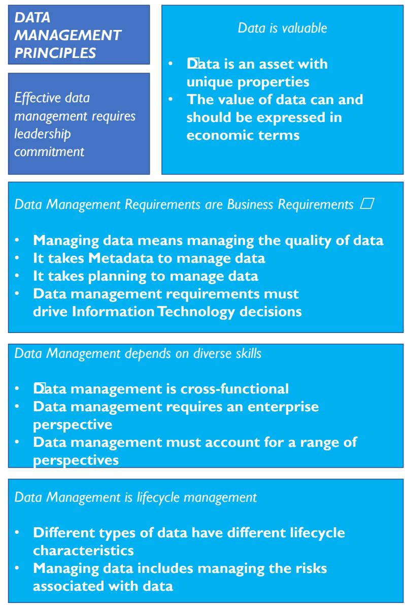
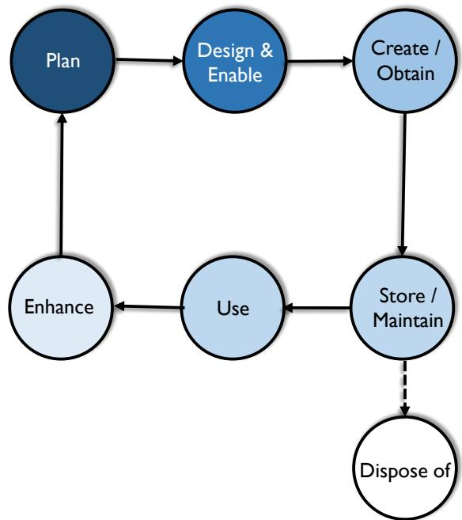
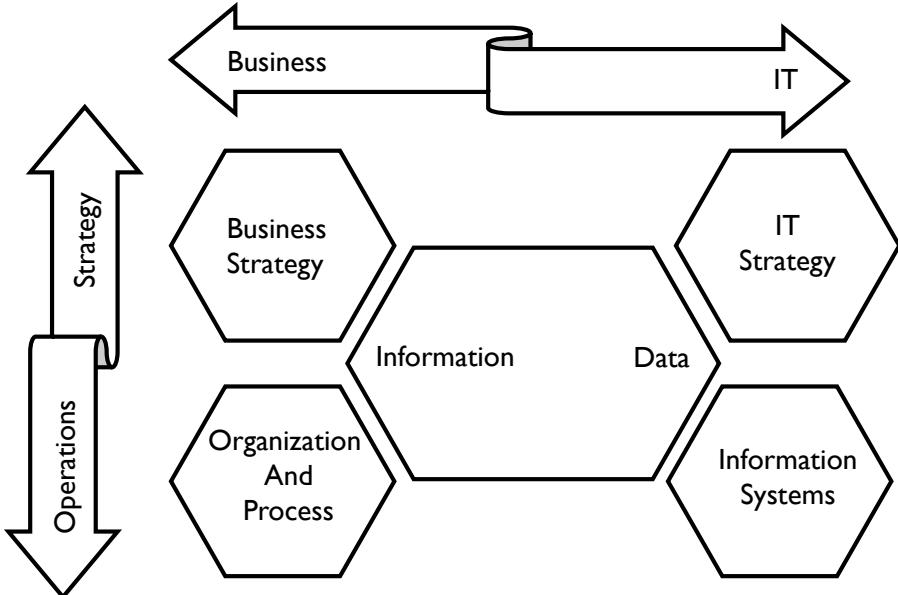
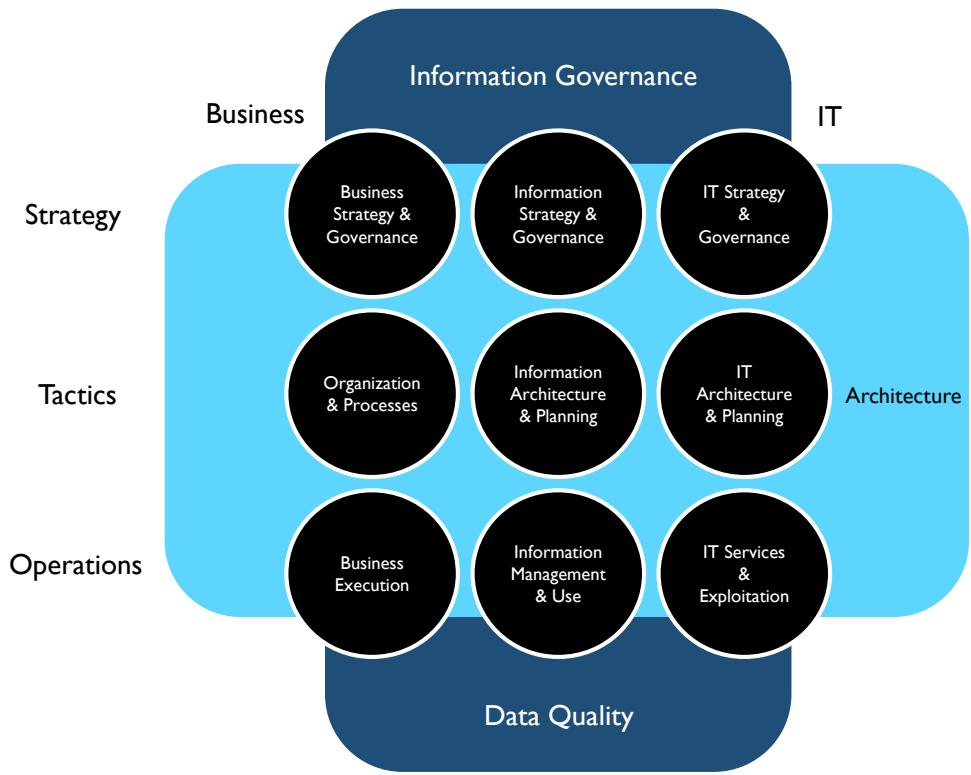
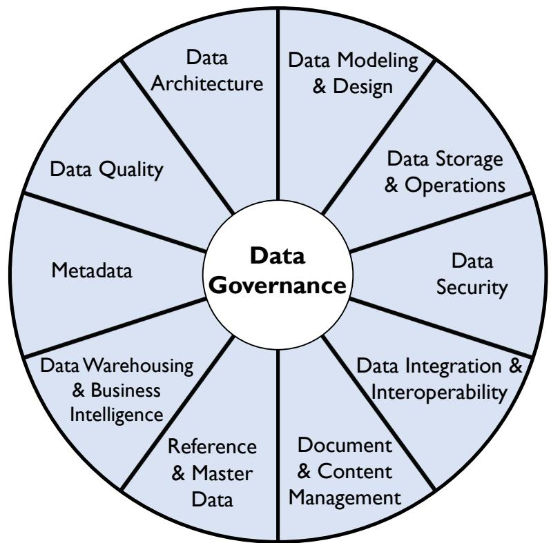
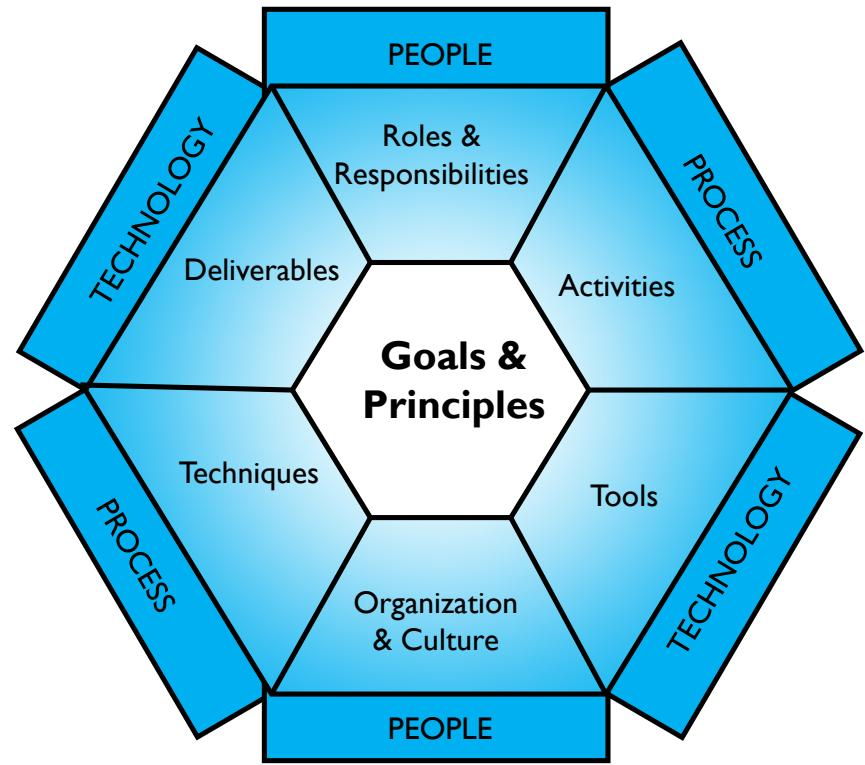
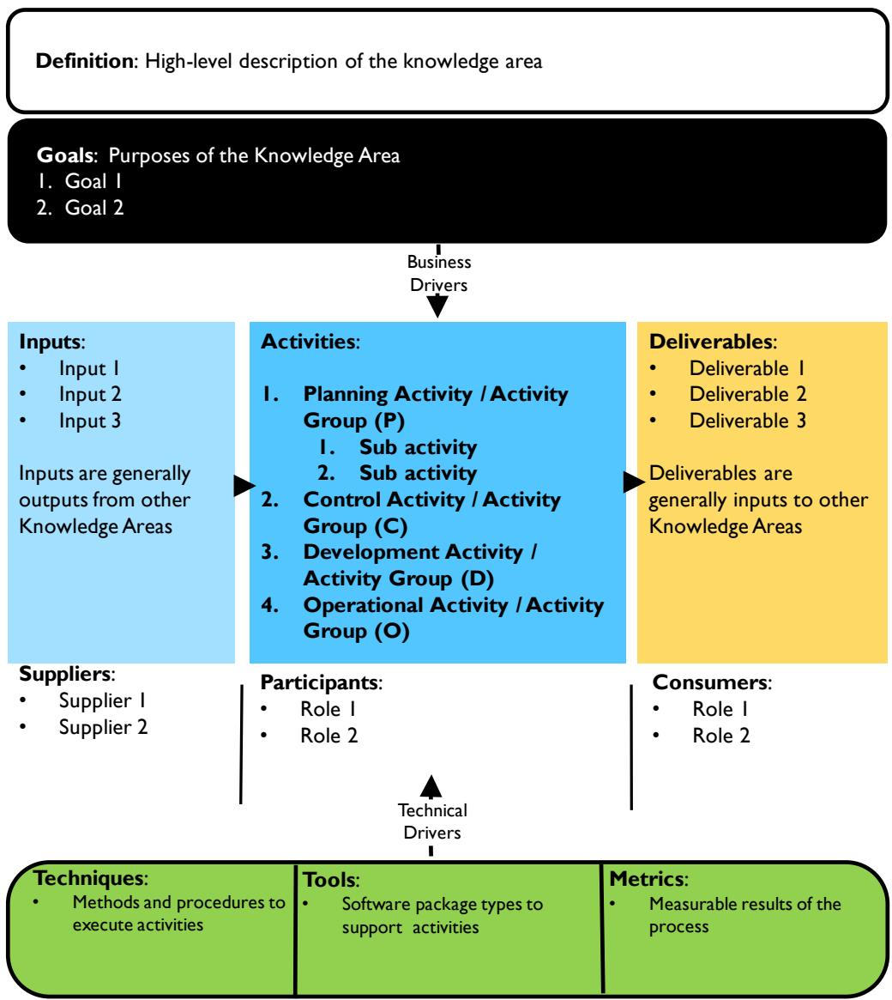
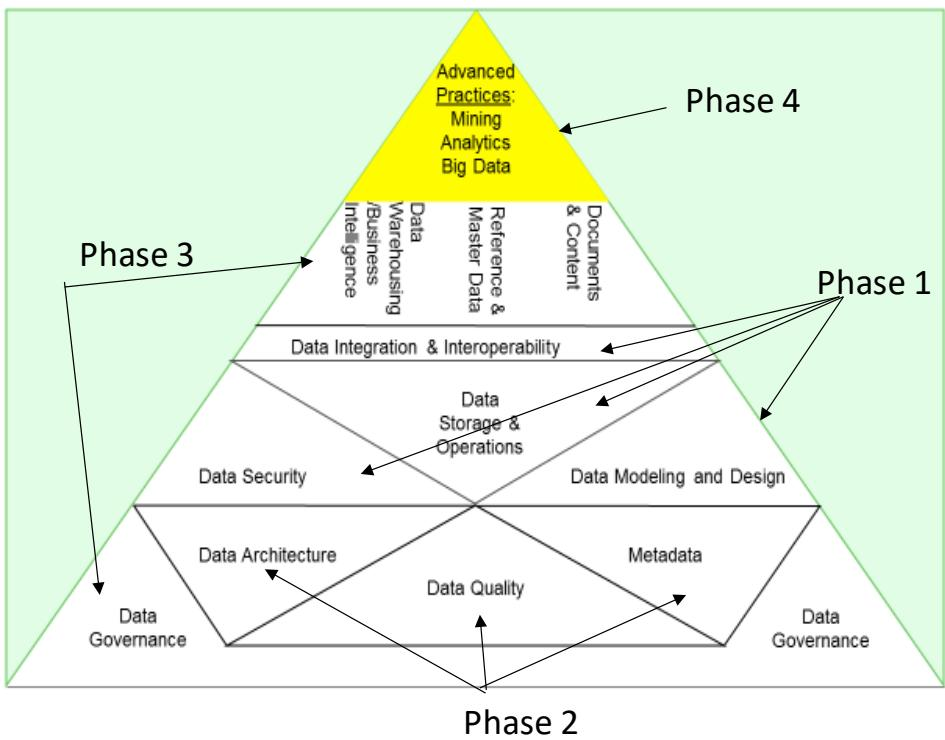
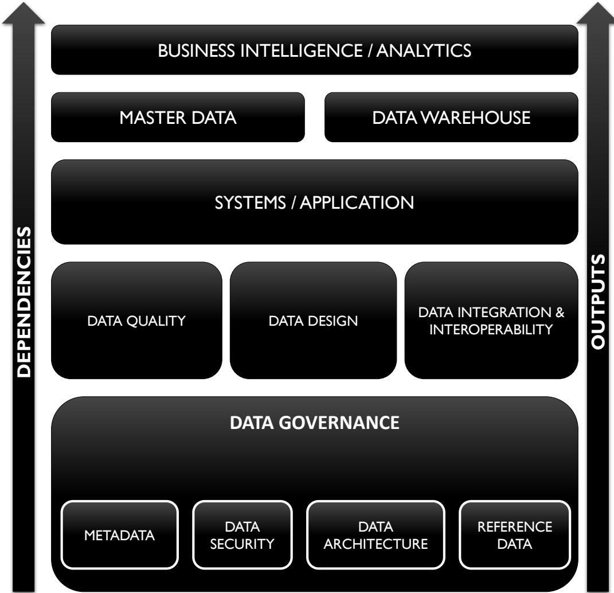
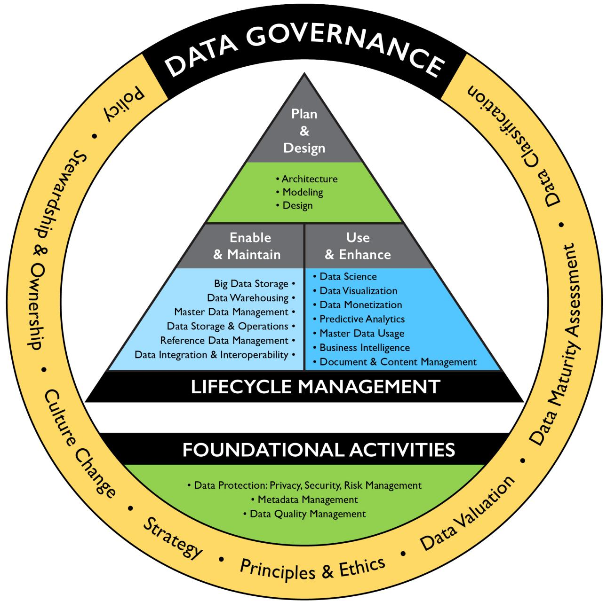

# Ch01 数据管理（Data Management）

> **章首学习框**
>
> **学习目标**
> 1. 能背出数据管理的官方定义，并拆解其关键词
> 2. 讲清数据作为资产的独特性，以及由此带来的管理挑战
> 3. 读懂 DAMA 三件套（车轮图/六边形/语境图）与 Aiken 金字塔，画出全书地图
>
> **前置知识**：无（本章为全书首章）
>
> **CDGA 考纲关联点**：数据管理定义 / 数据资产独特性 / 数据管理原则 / 车轮图（11 知识领域、治理居中）/ 环境要素六边形（7 要素）/ 语境图（SIPOC + PDOC）/ 数据生命周期 / Aiken 金字塔四阶段

## 本章导读

- 数据是**独特的组织资产**：非消耗、易复制难重建，决定了它不能照搬管钱管设备的办法。
- 数据管理 = 在**全生命周期**上交付、控制、保护并提升数据资产价值；业务与技术**共担责任**。
- **数据管理原则**回答"该怎么管"，**六项挑战**解释"为什么难管"。
- **DAMA 车轮图**是全书目录：数据治理居中，十个知识领域环绕；**语境图**（SIPOC+PDOC）是后续每章的统一阅读钥匙。
- **Aiken 金字塔**回答"从哪起步"：买应用 → 补质量与元数据 → 治理托底 → 高级分析。

## 1 数据管理是什么（What is Data Management）

先抛一个场景：一家融资担保公司，十年买了十几个业务系统——担保业务系统、风控系统、征信接口平台、监管报送系统……老板问："我们到底有哪些数据？归谁管？"没人答得上来。这就是**没有数据管理**的样子。本节回答：数据管理的定义、谁在管、为什么管。

### 1.1 数据管理的定义：计划、政策、方案、实践

**数据管理（Data Management）**的官方定义一句话讲完：

> 数据管理是：在数据资产全生命周期中，开发、执行和监督其**计划、政策、方案与实践（plans, policies, programs, practices）**，以**交付、控制、保护并提升（deliver, control, protect, enhance）**数据和信息资产的价值。

逐词拆解，记住四组关键词：

- **开发、执行、监督（development, execution, supervision）**：不只是"做"，还要"规划"和"盯"。三者缺一不可，光执行没人监督等于没管。
- **计划、政策、方案、实践（plans, policies, programs, practices）**：从战略到日常操作四个层次。类比后端：架构设计 → 编码规范 → 上线流程 → Code Review 日常。
- **交付、控制、保护、提升（deliver, control, protect, enhance）**：四个动词对应四种价值动作——给对的人用上、不出乱子、不被偷改、越用越值钱。
- **全生命周期（throughout their lifecycles）**：从产生、存储、使用、共享到归档销毁，每一段都算数。

🎤 面试考点：常被问"什么是数据管理"。答题要点：背出官方定义框架——开发/执行/监督 + 计划/政策/方案/实践 + 交付/控制/保护/提升 + 全生命周期，再补一句"核心是从数据资产中持续获取价值"。

**谁在管？数据管理专业人士（Data Management Professional）**是一个角色谱系：

- **高度技术侧**：数据库管理员（DBA）、网络管理员、程序员。
- **战略业务侧**：数据管家（Data Steward）、数据战略师（Data Strategist）、首席数据官（CDO）。

后端研发熟悉的是左端，治理岗考察的是右端。原书强调：数据管理**必须业务与技术共担责任**，两边协作才能保证数据质量满足战略需要。

📌 记住这个：数据管理 = 在全生命周期上，用计划/政策/方案/实践，交付、控制、保护并提升数据价值。

### 1.2 业务驱动因素与目标

**驱动因素一句话**：让组织能从数据资产中获取价值，就像管理资金和实物资产一样。不管理数据，等于不管理资本——结果是浪费与错失机会。

担保场景对照：客户征信数据可信，风控定价才准；担保余额数据不准，监管报送直接违规。

**目标 6 条**（原书 bullet 列表，压缩如下）：

| # | 目标 | 一句话 |
|---|------|--------|
| 1 | 理解信息需求 | 理解并支持企业与客户、员工、伙伴的信息需求 |
| 2 | 管好数据资产 | 捕获、存储、保护数据并保证完整性 |
| 3 | 保证数据质量 | 确保数据和信息的质量 |
| 4 | 保护隐私 | 确保利益相关者数据的隐私与保密 |
| 5 | 防止滥用 | 防止未授权或不恰当的访问、操纵和使用 |
| 6 | 数据增值 | 确保数据被有效利用、为企业增加价值 |

📌 记住这个：驱动只有一个——从数据资产获取价值；目标 6 条覆盖需求、资产、质量、隐私、防滥用、增值。

## 2 核心概念：数据、信息与资产（Data, Information and Asset）

### 2.1 数据的本质：数据是对世界的表征

先问一个问题：数据库里存着 `"2024-01-31"`，这代表什么？是客户签约日、放款日、还是担保到期日？**没有语境，这串字符什么都不是。**

定义先行：

- **数据（Data）**：对世界上事实的**表征（representation）**。它代表自身之外的东西。
- 数据既是对所表征对象的**一种解读**，本身又是**需要被解读的对象**。

由此推出两个推论：

- **数据需要语境（context）才能有意义**。语境是数据的表征系统：一套共同词汇 + 元素之间的关系。这些约定通常被记录在**元数据（Metadata）**里——这是后面 Ch13 元数据管理的伏笔。
- **同一概念有多种表征形态**。连"日期"这种有公认定义的概念，都有 `2024-01-31` / `31/01/2024` / `Jan 31, 2024` 多种写法。换成"客户""产品"这种复杂概念，粒度与细节见仁见智。担保业务系统和风控系统对"客户"的定义不一致，就是典型的表征分裂。

原书的结论：正因为表征会分裂，才需要数据架构、建模、治理、管家与元数据、数据质量管理来兜底——这正是 DMBOK 后续各章存在的理由。

📌 记住这个：数据是表征，不是事实本身；脱离语境的数据无法解读，语境约定就是元数据。

### 2.2 数据与信息：金字塔是错的

常见说法：数据是信息的原材料，信息是有语境的数据。DIKW 金字塔把四层排成塔形：

- **底层**：数据（Data）
- **向上**：信息（Information）→ 知识（Knowledge）→ **塔尖**：智慧（Wisdom）

DMBOK 对这个金字塔提出**三点批判**：

1. **数据不是天然存在的**。金字塔假设数据"就在那儿"，但数据必须被**创造**出来。
2. **创造数据本身需要知识**。从数据到智慧不是单向线性流程——你得先懂业务，才知道该采集什么字段。
3. **数据与信息相互纠缠**。数据是信息的一种形式，信息也是数据的一种形式：本季度的销售报表（信息）基于数仓数据生成，下季度它又变成计算环比增速的输入数据。

DMBOK 全书的处理方式：**两个词混用**。但在组织内部，为不同利益相关者划清"报表是信息、底表是数据"仍有沟通价值。

📌 记住这个：DIKW 金字塔的三处硬伤——数据要被创造、创造需要知识、数据与信息互为彼此。

### 2.3 数据作为组织资产

先给资产的会计定义，三个要素缺一不可：

- **可拥有或控制（owned or controlled）**
- **持有或产生价值（holds or produces value）**
- **可变现（can be converted to money）**

**数据全部满足**，因此被广泛认可为企业资产。但"像管理资产一样管理数据"的做法仍在演进中。类比商誉（goodwill）：上世纪 90 年代人们还在争论商誉该不该标价，如今它已是利润表（P&L）上的常规科目；数据变现（monetization）正在走同一条路——入表只是时间问题。

数据驱动的组织（data-driven）意味着：

- **决策方式**：停止拍脑袋，改用事件触发 + 分析获得可行动的洞察。
- **数据用途**：理解客户、创造产品服务、降本控险。
- **组织方式**：业务领导力与技术专业能力结成伙伴关系。

担保场景落地：代偿率分析驱动准入策略调整，就是"事件触发 + 分析洞察"；前提是代偿数据本身被专业地管理着。

📌 记住这个：数据满足资产三要素——可控制、有价值、可变现；数据驱动 = 用分析替代直觉决策。

## 3 数据管理原则（Data Management Principles）

管钱，花一分少一分；管设备，用一年旧一年。
管数据呢？复制一万份，成本几乎为零；删掉重建，代价是重跑整条业务链路。
**结论：照搬管钱、管设备的办法管数据，行不通。**

DAMA 为此给出一组数据管理原则（Data Management Principles），回答"数据该怎么管"。

口径先说明：原书图 1 按五个标签归组（11 条 bullet + 2 个独立标签），正文展开为 13 条陈述；市面与 CDGA 备考资料常称"十二原则"。本节按理解逻辑重排为四组 13 条讲全——考试遇到"十二"，知道指的是这套原则即可。

图 1 数据管理原则：原书按五个标签归组——数据有价值（2 条 bullet）、数据管理需求即业务需求（4 条）、依赖多元技能（3 条）、数据管理是生命周期管理（2 条，组名本身也是一条原则）、有效的数据管理需要领导层承诺（独立标签，组名即原则）。本节按理解逻辑重排为四组。

### 3.1 资产观组：数据是资产，就要按资产管

- **数据是有独特属性的资产（Data is an asset with unique properties）**：数据是资产，但使用不消耗。钱付出去就没了，设备越用越旧；征信数据查一次还在，还能喂给风控模型再用。
- **数据的价值应可用经济术语表达（The value of data can and should be expressed in economic terms）**：叫资产就得能估值，目前没有统一标准，组织要自建一致的量化方法。说不清客户征信数据值多少钱，就没法决定该投多少钱治理它。
- **管理数据就是管理数据质量（Managing data means managing the quality of data）**：数据管理的首要目标是数据"适用"（fit for purpose）。风控模型再强，客户表里"企业成立日期"错一半，审批结论就是垃圾。
- **管理数据需要元数据（It takes Metadata to manage data）**：管任何资产都要有"关于资产的数据"；数据摸不着，更得靠元数据（Metadata）来定义和理解。没有表注释、字段口径、血缘关系的数据库，就是没有台账的仓库。

### 3.2 组织观组：数据管理不是某个团队的事

- **管理数据需要规划（It takes planning to manage data）**：数据多处产生、多处流转，必须从架构和流程层面统一规划。担保系统、风控系统、监管报送各自建库不规划，就会出现三张对不上的"客户表"。
- **数据管理是跨职能的（Data management is cross-functional）**：一个团队管不了全组织的数据，需要技术与非技术技能协作。字段口径不是 DBA 能定的，得业务、风控、合规一起谈。
- **数据管理需要企业级视角（Data management requires an enterprise perspective）**：局部有效不够，要在全企业范围一致才最有效。这正是数据管理与数据治理（Data Governance）交织的原因。
- **数据管理必须兼顾多重视角（Data management must account for a range of perspectives）**：数据是流动的，用法和使用者一直在变，管理实践必须随之演进。今天为审批建的表，明天监管报送、经营分析都会来用。

### 3.3 生命周期观组：管数据就是管它的生老病死

- **数据管理是生命周期管理（Data Management is lifecycle management）**：数据有生命周期，且数据会生数据（data begets data），管理必须覆盖全程。一笔担保申请，生出审批记录、放款流水、征信上报、归档影像。
- **不同类型数据有不同生命周期特征（Different types of data have different lifecycle characteristics）**：类型不同，管理要求不同。合同影像要存十几年，埋点日志留 90 天就够，不能用一套保留策略。
- **管理数据包括管理数据风险（Managing data includes managing the risks associated with data）**：数据是资产，也是风险——会丢、会被偷、会被滥用，还有伦理问题。征信数据泄露，换来的是监管处罚和牌照风险。

### 3.4 技术与领导力组：技术服从数据，高层必须背书

- **数据管理需求驱动 IT 决策（Data management requirements must drive Information Technology decisions）**：后端常识，略——技术服务于数据战略而非相反，选型先问数据需求。
- **有效的数据管理需要领导层承诺（Effective data management requires leadership commitment）**：数据管理是跨部门的复杂流程，靠协调、协作与承诺运转。没有高层拍板，业务线不会让出排期去统一数据口径。

📌 记住这个：数据管理原则一句话——数据是特殊资产，要用经济语言估值、靠元数据和质量来管；要规划、要跨职能、要企业级视角；管的是全生命周期和数据风险；技术服从数据需求，领导层必须背书。

## 4 数据管理的挑战（Data Management Challenges）

数据难管，根子在数据本身。原书列出 13 项挑战，可归为六组：

| 组 | 挑战 | 一句话本质 |
|----|------|-----------|
| 4.1 | 资产特性与估值 | 数据不像任何传统资产，难以定价 |
| 4.2 | 数据质量 | 质量成本是隐性的，且极其昂贵 |
| 4.3 | 组织性挑战 | 数据横向流动，组织竖向割裂 |
| 4.4 | 数据生命周期 | 管理要覆盖从创建到销毁全程 |
| 4.5 | 风险与技术 | 监管已把数据当风险来管 |
| 4.6 | 领导力 | 缺高层承诺，一切无从谈起 |

### 4.1 数据区别于其他资产：它不守物理世界的规矩

先看一个场景。公司买一台服务器，财务立刻知道怎么做：入账、折旧、盘点、报废。公司积累十年的客户征信数据，财务能入账吗？值多少钱？丢了怎么赔？答不上来。

原因在于数据有五条独特属性：

- **非消耗性（Non-consumable）**：使用不消耗数据。一台服务器只能跑有限任务，同一份客户名单可被风控、营销、报送同时使用。
- **无形却耐久（Intangible yet durable）**：摸不着，但不会磨损。不过价值会随时间变化。
- **易复制、难重建**：复制一份成本接近零；一旦丢失且没有备份，重建成本极高甚至不可能。
- **可被偷走却不消失**：物理资产被偷就没了；数据被偷了你手里还有，很难察觉。
- **越用越多**：每次使用都留下新的数据轨迹，数据量只增不减。

这些属性直接推出四个管理难题：

- **估值难**：没有市价，无法像股票一样算价值。
- **确权难**：多人同时使用，归谁所有说不清。
- **盘点难**：说不清自己到底有多少数据。
- **防滥用难**：复制无感，滥用无痕。

🎤 面试考点：常被问"数据资产和固定资产有什么区别"。答题要点：先列非消耗、无形耐久、易复制难重建三条属性，再落到估值难、确权难两个后果。

#### 4.1.1 数据估值：先分类，再算账

估值（Valuation）= 收益 − 成本。股票的账好算，买卖差价一目了然。数据的成本和收益都没有标准，只能先在组织内部统一类别。

**成本侧五类**：

| # | 成本类别 |
|---|---------|
| 1 | 获取与存储数据的成本 |
| 2 | 数据丢失后的重建成本 |
| 3 | 数据缺失对组织的影响 |
| 4 | 风险缓释成本与风险潜在损失 |
| 5 | 改进数据的成本 |

**收益侧四类**：

| # | 收益类别 |
|---|---------|
| 1 | 更高质量数据带来的收益 |
| 2 | 竞争对手愿意为这些数据付多少钱 |
| 3 | 数据本身能卖多少钱 |
| 4 | 数据创新用途的预期收入 |

两个估值陷阱：

- **情境性（Contextual）**：对 A 公司值钱的数据，对 B 公司可能一文不值。
- **时效性（Temporal）**：昨天值钱，今天可能不值钱。

例外是可靠的客户信息。它随客户行为数据的积累而增值，是组织内少数长期稳定增值的数据。

给数据定价不是终点，而是手段。组织只有用财务语言理解数据，才能用同一套逻辑做投资决策——这也为数据管理活动本身定了价。

### 4.2 数据质量：最贵的成本藏在看不见的地方

程序员有句老话：**垃圾进，垃圾出（Garbage in, garbage out）**。说这话的人往往想就此免责。用数据的人免责不起。

IT 团队常轻视自己系统里存的数据。业务方则默认数据可信，直到被坑一次。**信任一旦失去，极难重建**——风控模型用了错误的征信数据做出错误审批，业务方此后会绕开所有数据产品，宁可手工查。

两个必须记住的数字：

| 数字 | 来源 |
|------|------|
| 组织营收的 **10%–30%** 花在处理数据质量问题上 | 行业专家估计 |
| **3.1 万亿美元**：2016 年低质量数据给美国造成的损失 | IBM 估计 |

低质量数据的成本共九类，多数是隐性、间接的：

| # | 成本 | 显性/隐性 |
|---|------|----------|
| 1 | 废品与返工（Scrap and rework） | 隐性 |
| 2 | 变通办法与隐藏的修正流程 | 隐性 |
| 3 | 组织低效、生产力下降 | 隐性 |
| 4 | 组织内冲突 | 隐性 |
| 5 | 员工工作满意度降低 | 隐性 |
| 6 | 客户不满 | 隐性 |
| 7 | 机会成本，包括丧失创新能力 | 隐性 |
| 8 | 合规成本与罚款 | 显性 |
| 9 | 声誉损失 | 隐性 |

口径说明：原书仅明确罚款类为直接成本，其余多为隐性、间接成本。

高质量数据的收益共六类：

- **改善客户体验**
- **提高生产力**
- **降低风险**
- **能抓住业务机会**
- **增加收入**
- **从客户、产品、流程洞察中获得竞争优势**

结论：质量管理不是一次性项目。它要求把质量**内建（build in）到流程和系统里**。所有数据管理职能都影响质量，都必须对质量负责。

🎤 面试考点：常被问"低质量数据的代价有多大"。答题要点：抛出 10%–30% 营收和 IBM 3.1 万亿两个数字，再补一句"多数成本是隐性的，所以长期被低估"。

### 4.3 组织性挑战：数据横向流动，组织竖向割裂

技术问题好解，组织问题难解。五项挑战可以合并为一组：

- **规划被挤压**：数据价值不会自动产生，需要架构、建模等战略规划。现实是时间与金钱的压力永远优先，规划永远让位。
- **元数据也要被管理**：元数据（Metadata）描述组织有什么数据、从哪来、谁可用、质量如何。但**元数据本身也是数据**。数据管不好的组织，元数据根本没人管。
- **跨职能协作难**：管数据需要设计、运维、分析、语言、战略五类技能。让这些背景迥异的人朝共同目标协作，本身就是挑战。
- **横向数据 vs 竖向组织**：数据天然横向流动，穿过销售、运营、风控各部门；组织却是竖向竖井。同一概念（客户、产品）各部门表述不同，集成时处处踩坑。
- **多视角难兼顾**：内部数据与外部采购数据并存，不同国家、行业的合规要求各异。造数据的人常忘了后面还有人要用。

### 4.4 数据生命周期：管理必须覆盖从创建到销毁

数据像产品一样有**生命周期（Data Lifecycle）**。注意：它不同于**系统开发生命周期（SDLC）**——SDLC 管系统，生命周期管数据，系统死了数据还活着。

*图 2 数据生命周期关键活动：六个环节构成主循环，销毁是单向出口。*

逐一讲清图中元素：

- **规划（Plan）**：深色节点，循环的起点与归点。决定需要什么数据、怎么管。
- **设计与启用（Design & Enable）**：设计系统与架构，让数据能被产生和使用。
- **创建/获取（Create / Obtain）**：数据诞生——自己产生，或从外部获取。
- **存储/维护（Store / Maintain）**：入库、备份、运维。
- **使用（Use）**：数据产生价值的环节。
- **增强（Enhance）**：使用中清洗、转换、合并、聚合，产生新数据，箭头回到 Plan——**循环意味着每次使用都在酝酿下一轮规划**。
- **销毁（Dispose of）**：白色节点，从 Store/Maintain 用**虚线**引出。虚线含义：销毁不进入主循环，是单向出口。

生命周期之外还有一条暗线：**数据血缘（Data Lineage）**，即数据从源头到使用点的移动路径，又称数据链。生命周期讲"经历哪些阶段"，血缘讲"经过哪些系统"。两者交叉，理解得越清，管得越好。

聚焦生命周期的五条推论：

- **创建与使用是最关键的两点**：生产数据花钱，数据只有被消费才有价值。管数据必须懂它怎么来、怎么用。
- **质量须贯穿全程**：低质量数据是成本和风险，不是价值。📎 勘误：原书此处误作 "the quality of quality can be impacted"，应为 "the quality of data"。
- **元数据质量同样要管**：元数据也是数据，组织靠它管理其他数据。
- **安全须贯穿全程**：从创建到销毁，需要保护的数据全程保护。
- **聚焦最关键数据，最小化数据 ROT**：ROT 指**冗余（Redundant）、过时（Obsolete）、琐碎（Trivial）**的数据。组织大量数据从未被使用，全管是不可能的，管住关键的、清掉 ROT 才现实。

### 4.5 数据与风险、技术：监管已经把数据放上风险登记册

数据是资产，也是负债。三层递进：

- **数据分类是管理前提**：可按类型（交易数据、参考数据、主数据、元数据）、内容、格式、防护等级分类。不同类型风险不同、管法不同，细节留到 Ch05/Ch10。
- **信息缺口是企业负债**：**信息缺口（Information Gap）**= 做有效决策需要知道的 − 已经知道的。缺口直接影响运营效率和盈利能力。
- **监管先行于会计**：会计准则还没把数据放上**资产负债表（Balance Sheet）**当资产，监管已把它放上**风险登记册（Risk Register）**当风险管。萨班斯法案（SOX）管财务数据的准确与控制，偿付能力 II（Solvency II）管保险业风险模型底层数据的血缘与质量，各国隐私法管个人数据的处理。

对融资担保行业这不是抽象概念：监管报送数据出错就是罚款，客户征信数据滥用就是合规事故。

技术与数据的关系一句话带过：**数据需求驱动技术决策，而不是相反**。管理技术不等于管理数据。别让"上新系统"的诱惑替你做数据决策——对后端研发，这条几乎是常识。

### 4.6 领导力与 CDO：数据管理是业务工程，不是 IT 工程

《领导者数据宣言》（Leader's Data Manifesto，2017）断言：组织最好的内生增长机会在数据里。现实却是多数组织离**数据驱动（Data-Driven）**很远：

- **家底不清**：不知道自己有什么数据、什么数据最关键
- **混淆数据与 IT**：两者都管砸
- **缺乏战略高度**：不从战略高度对待数据
- **低估工作量**：低估数据管理的工作量

这正是**首席数据官（Chief Data Officer, CDO）**角色兴起的原因：数据管理必须由业务驱动、高层挂帅，不能继续当 IT 部门的附属职能。CDO 的职权与定位留到 Ch16/Ch17 展开。

📌 记住这个：数据因非消耗、易复制难重建而难估值、难确权；质量问题吞掉营收 10%–30% 且多为隐性；生命周期从 Plan 到 Dispose 全程要管质量、元数据、安全，并聚焦关键数据、清除 ROT；监管已把数据放上风险登记册；这一切没有高层承诺推不动。

## 5 数据管理战略（Data Management Strategy）

先给结论：战略不是口号，是一组相互咬合的选择。数据管理战略回答一个问题——公司打算怎样管好数据，让它持续产生价值。

### 5.1 战略是什么：一组通向高层目标的选择

**问题场景**：担保公司同时上了担保业务系统、征信接口、风控模型平台。每个团队都在"管数据"，但方向各不相同。

没有战略时，这就是三支各自为战的队伍。

**定义**：战略（Strategy）是一组选择与决策，共同描绘达成高层目标的行动路线。

类比下棋：战略是一系列有顺序的着法，目标是将杀或逼和。

关键不在单步棋多精妙，而在步与步之间的连贯。

### 5.2 数据战略从业务战略推导，数据管理战略做支撑

两层战略，别混淆：

| 层次 | 回答的问题 | 类比 |
|------|-----------|------|
| **数据战略（Data Strategy）** | 需要什么数据、从哪获取、如何利用它赢得竞争 | 产品规划：要解决什么业务问题 |
| **数据管理战略（Data Management Strategy）** | 如何维护和提升数据的质量、完整性、访问与安全 | 技术规划：用什么架构和流程去落地 |

推导方向是单向的：先读懂业务战略里隐含的数据需求，再定数据战略，最后配数据管理战略。

融资担保例子：业务战略是"小额批量担保、秒级审批"。推导出的数据需求是实时征信、自动化风控规则。数据管理战略就要回答：征信数据质量谁负责、报送监管的数据如何保证一致。

**谁牵头**：多数组织由**首席数据官（Chief Data Officer, CDO）**牵头——拥有并维护战略；**数据治理团队（data governance team）**负责执行；**数据治理委员会（Data Governance Council）**提供支持。

常见做法：委员会还没成立时，CDO 先起草初稿，用它争取高层对治理的承诺。

### 5.3 战略的十个组成部分

一份完整的数据管理战略应包含以下内容：

| # | 组成部分 | 一句话说明 |
|---|---------|-----------|
| 1 | **愿景（Vision）** | 数据管理要抵达的图景，要有说服力 |
| 2 | **业务案例（Business Case）** | 为什么值得做，附精选示例 |
| 3 | **指导原则与价值观** | 做事的基本立场 |
| 4 | **使命与长期目标** | 数据管理的方向性目标 |
| 5 | **成功度量（Measures of Success）** | 怎么判断做成了 |
| 6 | **短期目标（12–24 个月）** | 符合 SMART 原则 |
| 7 | **角色与组织** | 谁负责、有什么决策权 |
| 8 | **计划组成与举措** | 要做哪几件事 |
| 9 | **优先级工作计划** | 带范围边界的排序清单 |
| 10 | **实施路线图草案** | 项目与行动项排期 |

第 6 项的 **SMART** 是五个词的缩写展开：具体（Specific）、可度量（Measurable）、可行动（Actionable）、现实（Realistic）、有时限（Time-bound）——对后端研发是老概念。

注意第 9 项的"范围边界"。战略的价值一半在于明确**不做什么**。

### 5.4 三个交付物：章程、范围声明、路线图

战略规划最终沉淀为三个文档。这是 CDGA 考点，记住名字与分工：

| 交付物 | 中文译名 | 内容 |
|--------|---------|------|
| **Data Management Charter** | 数据管理章程 | 愿景、业务案例、目标、原则、成功度量、关键成功因素、已识别风险、运营模式 |
| **Data Management Scope Statement** | 数据管理范围声明 | 某个规划期（通常 3 年）内的目标，以及达成目标的角色、组织和责任人 |
| **Data Management Implementation Roadmap** | 数据管理实施路线图 | 具体的项目、任务分配、交付里程碑 |

类比后端项目：章程是立项书，范围声明是 OKR 加责任人，路线图是排期表。

战略应覆盖与本组织相关的所有 DAMA 知识领域——也就是下一节车轮图里的内容。

📌 记住这个：数据战略从业务战略推导；数据管理战略由 CDO 牵头，产出三个交付物——章程、范围声明、路线图。

## 6 数据管理框架（Data Management Frameworks）

**问题场景**：打开数据管理的任务清单——建模、存储、安全、质量、元数据、仓库……几十项工作互相牵连，像一锅粥。从哪下手？

答案：先要有地图。框架（Framework）就是地图，帮你看到全貌，以及各部分之间的关系。

本节按三组框架视角，从三种抽象层次"看地图"：

| 框架 | 抽象层次 | 作用 |
|------|---------|------|
| SAM / AIM | 最高层：业务与 IT 的关系 | 理解影响数据管理的组织因素 |
| DAMA 车轮图 / 六边形 / 语境图 | 中层：知识领域全景 | 定义数据管理包含什么 |
| Aiken 金字塔 / 演进框架（演进框架见 §7.1） | 关系层：领域之间的依赖 | 回答先做哪个、后做哪个 |

### 6.1 SAM 与 AIM：业务与 IT 的对齐模型

这两个模型主旨相同：数据管理决策受业务与 IT 之间关系制约。非 CDGA 重点，知道主旨即可。

**战略一致性模型（Strategic Alignment Model, SAM）**：核心是数据与信息的关系，外围是四个战略域——业务战略、IT 战略、组织基础设施与流程、IT 基础设施与流程。

SAM 四域结构：四角分别是业务与 IT 的战略和运营，信息偏业务侧，数据偏 IT 侧。

**阿姆斯特丹信息模型（Amsterdam Information Model, AIM）**：九宫格结构，在战略与运营之间加了中间层——结构与战术（含规划与架构），并强调信息治理与数据质量这根沟通支柱。

AIM 九宫格：三层（战略/战术/运营）× 三列（业务/信息沟通/IT）。

一句话记忆：SAM 看四域对齐，AIM 多了战术中间层。

### 6.2 DAMA 三件套：车轮图、六边形、语境图

DAMA 框架用三张图回答三个问题：数据管理包含哪些领域、每个领域由什么要素构成、每个领域内部怎么运转。

#### 6.2.1 DAMA 车轮图（The DAMA Wheel）：治理居中，十领域环绕

车轮图定义了数据管理的知识领域（Knowledge Areas）。这是全书最重要的一张图。

逐一讲清图中元素：

- **轮心：数据治理（Data Governance）**。居中不是摆姿态，是因为各职能内部的一致性与职能之间的平衡，都靠治理来保证。类比微服务架构里的服务治理：没有它，每个服务各自演进，最终无法协同。
- **轮辐：十个知识领域**。环绕轮心；十个领域的完整定义见 §7.2 表格，此处不再罗列。
- **都是必需项，但不必同时上马**。成熟的数据管理职能需要全部领域；具体什么时候实施哪个，取决于组织需求。

这些知识领域正是 DMBOK 第 3–13 章的主题。车轮图就是全书的目录。

🎤 面试考点：常问"DAMA 车轮图讲什么、为什么治理在中心"。答题要点：11 个领域（1 治理 + 10 知识领域），治理居中是因为它保证各领域的一致性与平衡。

#### 6.2.2 环境要素六边形（Environmental Factors Hexagon）：目标与原则居中

车轮图告诉你有哪些领域，六边形告诉你每个领域由什么要素构成。

六边形共七个要素，逐一讲清：

- **中心：目标与原则（Goals and Principles）**。居中是因为它们指导人们如何执行活动、如何有效使用工具。方向错了，工具越好偏得越远。
- **环绕的六个要素**：
  - **活动（Activities）**：这个领域做什么
  - **交付物（Deliverables）**：产出什么有形结果
  - **角色与职责（Roles and Responsibilities）**：谁来做
  - **方法与技术（Techniques）**：用什么方法做
  - **技术工具（Tools）**：用什么软件做
  - **组织与文化（Organization and Culture）**：在什么样的组织环境里做

六边形的六条外边标注了 People / Process / Technology 三类归属（各两条边）——环绕的六个要素分属人、流程、技术三大族。类比后端团队：目标与原则是技术愿景，活动是迭代，交付物是上线功能，角色是人员分工，方法是规范流程，工具是技术栈，组织与文化是团队氛围。

#### 6.2.3 知识领域语境图（Knowledge Area Context Diagram）：后续每章的阅读钥匙

语境图是六边形的展开，描述单个知识领域内部的运转细节。DMBOK 后续每章开头都有一张，读法完全统一——学会读这一张，后面十章都通。

语境图基于 SIPOC——供给者（Suppliers）、输入（Inputs）、流程（Processes）、输出（Outputs）、消费者（Consumers），这是产品管理常用的流程描述工具。每张语境图都以该知识领域的**定义（Definition）与目标（Goals）**开头——先讲清这个领域是什么、要达成什么，再展开运转细节。逐个区域讲清：

- **中央：活动（Activities）**。活动居中，因为正是活动产出了满足干系人需求的交付物。活动按 **PDOC** 四阶段分类：

| 阶段 | 含义 | 后端类比 |
|------|------|---------|
| **P（Plan，计划）** | 定战略与战术路线，周期性开展 | 季度技术规划 |
| **D（Develop，开发）** | 围绕系统开发生命周期（SDLC）：分析、设计、构建、测试、部署 | 需求到上线的研发流程 |
| **O（Operate，操作）** | 支持系统与流程的使用、维护与增强 | 日常运维与迭代优化 |
| **C（Control，控制）** | 保障数据质量与系统的完整性、可靠性、安全性 | 监控、告警、审计 |

- **左侧：输入（Inputs）与供给者（Suppliers）**。输入是启动活动所需的有形之物（如业务战略），供给者是提供输入的人。箭头流入中央。
- **右侧：交付物（Deliverables）与消费者（Consumers）**。交付物是活动产出的有形结果，消费者是直接从交付物受益的人。箭头流出。
- **下方：参与者（Participants）**。执行、管理或审批活动的人。注意与六边形里的**角色与职责（Roles and Responsibilities）**区分：后者是概念性分组，前者是具体执行、管理、审批活动的人。
- **底部：工具（Tools）、技术（Techniques）、度量指标（Metrics）**。支撑整个领域的手段与衡量标准。

注意一点：图中清单是示意性的，不是穷举。每个组织应按需裁剪。

三件套的分工：车轮图给领域全景，六边形给领域构成，语境图给领域内部细节。

### 6.3 Aiken 金字塔（DMBOK Pyramid / Aiken Pyramid）：从买应用到高级分析的四个阶段

**问题场景**：面试官问"你们公司数据治理该怎么起步"。你需要一条讲得清先后次序的路径。Aiken 金字塔就是标准答案的骨架。

现实里很少有组织能先定好数据战略再动手。多数公司是边用边补，Peter Aiken 用金字塔描述了这条典型演进路径。

四个阶段，逐一讲清：

| 阶段 | 发生了什么 | 融资担保例子 |
|------|-----------|-------------|
| **阶段 1：买应用** | 采购带数据库能力的应用，自动获得数据建模/设计、存储、安全的起点能力；让系统在本环境跑起来需要集成与互操作 | 上线担保业务系统，有了客户表、合同表，做了权限控制 |
| **阶段 2：暴露质量问题** | 用起来后发现数据质量差；提升质量依赖可靠的元数据与一致的数据架构，它们说清不同系统的数据如何配合 | 同一客户在担保系统和征信接口里姓名不一致，排查需要元数据 |
| **阶段 3：治理托底** | 管好质量、元数据、架构需要数据治理提供结构性支撑；治理到位后，才能执行文件与内容管理、参考数据与主数据管理、数仓与 BI 等战略举措 | 成立治理委员会、定数据标准后，主数据平台和监管报送数仓才建得起来 |
| **阶段 4：高级分析** | 享受良序数据的红利，发展高级分析能力 | 风控模型迭代、反欺诈、客户画像 |

金字塔的两个驱动思想，看似矛盾实则互补：

- **地基论**：高级实践是塔尖，必须建在底座之上。塔尖下面是地基，顺序有依赖。
- **顺序可灵活**：各组件可以按任意顺序放置。不是每家公司都严格走四阶段，可以按需裁剪。

Aiken 金字塔脱胎于车轮图，又反过来补充车轮图：知识领域不是可以任意互换的积木，它们之间有依赖关系。

🎤 面试考点：常问"一家初创公司数据管理怎么起步"。答题要点：按 Aiken 金字塔讲四阶段——先买应用获得基础能力，再补质量与元数据，再上治理托底战略举措，最后做高级分析；并补一句"顺序可灵活，但依赖关系不能倒置"。

📌 记住这个：三组框架三种视角——SAM/AIM 看业务 IT 对齐，DAMA 三件套（车轮图/六边形/语境图）定义知识领域，Aiken 金字塔与演进框架（见 §7.1）回答先后次序与依赖。语境图（SIPOC + PDOC）是后续每章的统一阅读钥匙。

## 7 DMBOK 全书地图（The DMBOK Overview）

车轮图回答了"数据管理包含什么"，没回答"先做哪个"。

注意区分：§6.3 的 Aiken 金字塔回答的是**时序路径**——多数组织实际走过的先后顺序；本节的演进框架回答的是**静态依赖关系**——谁依赖谁，与组织当前走到哪一步无关。

场景：担保公司老板拍板"上风控驾驶舱大屏"。BI 团队开工三个月，发现客户主数据对不上、风险口径每个系统一个版本。大屏被迫延期。

问题出在哪？下面两张演进图给出答案：**上层应用依赖下层基础，跳层必返工。**

### 7.1 依赖决定先后：BI 依赖一切，治理是地基

功能依赖图、功能框架、车轮演进图三张图合称 DAMA 框架的**演进视角（演进框架）**——本节把它们连起来讲。

依赖关系图（Functional Framework Dependencies）：左侧向上箭头是依赖（Dependencies），右侧向上箭头是产出（Outputs）。

自下而上逐层读：

- **数据治理（Data Governance）居底**：内部嵌着**元数据（Metadata）**、**数据安全（Data Security）**、**数据架构（Data Architecture）**、**参考数据（Reference Data）**——四块地基。
- **数据质量（Data Quality）/ 数据设计（Data Design）/ 数据集成与互操作（Data Integration & Interoperability）**：建在地基之上。
- **系统与应用（Systems / Application）**：业务系统产生的数据靠下面三层托底。
- **主数据（Master Data）/ 数据仓库（Data Warehouse）**：跨系统的整合层。
- **BI / 分析（Business Intelligence / Analytics）居顶**：依赖图中的一切。

一句话读法：**越靠上依赖越多；BI 是最顶层的"用户可见功能"。**

后端类比：上线服务前要先有监控、CI/CD、测试环境。BI 就是用户可见的功能，治理和基础活动是平台基建——基建缺失，功能能上线但跑不稳。

回到驾驶舱场景：主数据对不上，是因为跳过了底层的主数据与治理，直接从"系统与应用"往"BI"跳。

同一个框架还能按职能切成三层，即功能框架（Data Management Function Framework）：

- **监督层（Oversight）**：数据治理。管战略、数据估值、原则与伦理、政策、数据管理职责（Stewardship）、文化变革。
- **生命周期管理层（Lifecycle Management）**：规划与设计（Plan & Design）→ 启用与维护（Enable & Maintain）→ 使用与增强（Use & Enhance）。建模、架构、存储运维、数仓、大数据存储、数据变现都在这一层。
- **基础活动层（Foundational Activities）**：横跨整个生命周期的三件事——**数据风险管理**（安全、隐私、合规）、**元数据管理**、**数据质量管理**。

核心洞察：**只做生命周期职能、不做基础与监督，数据价值大打折扣。**基础活动做好，数据维护更便宜、使用者更有信心、可用场景更多。

车轮演进图（DAMA Wheel Evolved）：把同一框架画回车轮——元数据、质量、架构等核心活动居中，生命周期与使用活动环绕，治理在外圈提供约束。

📌 记住这个：DAMA 演进视角的结论是依赖关系——治理与基础活动是地基，BI/分析是屋顶；只建屋顶不建地基，数据价值大打折扣。

### 7.2 十一大知识领域：全书第 3~13 章的目录

DMBOK 的主体是 11 个知识领域（Knowledge Area），每个对应一章。

| 知识领域 | 一句话定义 | 章节 |
|----------|-----------|------|
| 数据治理（Data Governance） | 建立数据决策权体系，为数据管理提供方向与监督 | Ch03 |
| 数据架构（Data Architecture） | 对齐组织战略，定义数据资产的管理蓝图 | Ch04 |
| 数据建模与设计（Data Modeling and Design） | 用数据模型精确发现、分析、表达并沟通数据需求 | Ch05 |
| 数据存储与操作（Data Storage and Operations） | 设计、实施、支持数据存储，覆盖从规划到处置的全生命周期 | Ch06 |
| 数据安全（Data Security） | 保障隐私与机密性，防泄露，确保数据被恰当访问 | Ch07 |
| 数据集成与互操作（Data Integration and Interoperability） | 数据在存储、应用、组织之间的移动与整合 | Ch08 |
| 文档与内容管理（Document and Content Management） | 非结构化数据与信息的全生命周期管理，支撑法律与监管合规 | Ch09 |
| 参考数据与主数据（Reference and Master Data） | 核心共享数据的持续调和与维护，保证各系统用上"唯一真实版本" | Ch10 |
| 数据仓库与商务智能（Data Warehousing and Business Intelligence） | 管理决策支持数据，让知识工作者通过分析与报表获得价值 | Ch11 |
| 元数据（Metadata） | 管理定义、模型、数据流等"描述数据的数据" | Ch12 |
| 数据质量（Data Quality） | 度量、评估并改进数据对用途的适用性 | Ch13 |

对你（后端研发）来说：Ch06、Ch07、Ch08 是老本行的新视角；Ch03、Ch12、Ch13 是治理岗的核心新词。

每个知识领域章结构统一，共 7 个部分：

1. **引言**：业务驱动、目标与原则、基本概念
2. **活动**
3. **工具**
4. **技术**
5. **实施指南**
6. **与数据治理的关系**
7. **度量**

记住这个结构，后面每章的语境图和课件都按它展开。

11 章之外，还有 5 个非知识领域章：

- **数据伦理（Data Handling Ethics）**：数据采集、分析、使用中的伦理底线（Ch02）
- **大数据与数据科学（Big Data and Data Science）**：海量多样数据催生的技术与业务流程（Ch14）
- **数据管理成熟度评估（Data Management Maturity Assessment）**：评估并改进组织数据管理能力的方法（Ch15）
- **数据管理组织与角色期望（Data Management Organization and Role Expectations）**：数据团队怎么搭、角色怎么定（Ch16）
- **数据管理与组织变革管理（Data Management and Organizational Change Management）**：数据实践落地所需的文化变革（Ch17）

没有哪家企业会做完所有知识领域的所有活动。全景地图的价值在于：知道全局，才能选对聚焦点。

📌 记住这个：11 个知识领域 = Ch03~Ch13，每章结构固定为"引言/活动/工具/技术/实施指南/与治理的关系/度量"；另有伦理、大数据、成熟度、组织、变革 5 章补充。

### 7.3 DAMA 与 DMBOK：协会、框架与认证

一句话定位：DAMA 是协会，DMBOK 是协会编的知识体系指南。

- **DAMA（Data Management Association，国际数据管理协会）**：为解决数据管理挑战而成立的全球性专业协会。
- **DMBOK（Data Management Body of Knowledge，数据管理知识体系指南）**：DAMA 编写的权威参考书，三大作用：
  - **功能框架**：给出企业数据管理实施的原则、实践、方法、角色、交付物与度量
  - **通用词汇**：统一数据管理概念的共同语言，是最佳实践的基础
  - **认证基础**：CDMP（Certified Data Management Professional，数据管理专业人士认证）考试的官方参考
- **CDGA / CDGP**：DAMA 中国推出的国内对应认证——数据治理工程师 / 数据治理专家，知识体系同样基于 DMBOK。

📌 记住这个：DMBOK 三大作用——功能框架、通用词汇、CDMP 认证基础；国内对应认证是 CDGA/CDGP。

## 8 落地视角：中小公司的第一刀切在哪

DMBOK 是全量框架，没有公司能一次做完。中小公司裁剪原则：

**第一刀：数据盘点，而不是买平台**

- 用一张表登记核心系统、核心表、负责人、数据流向——这就是最朴素的元数据管理。
- 对应 Aiken 金字塔：多数中小公司处在阶段 1~2 之间，先承认这一点。
- 盘点产出物本身就是向高层要资源的弹药（对应 §5.4 章程的业务案例）。

**裁剪三原则**：

- **聚焦关键数据**：用 ROT 原则砍掉不管的清单，比决定要管什么更重要（§4.4）。
- **估值不求精确求一致**：中小公司别纠结数据入表，用 §4.1.1 的成本/收益类别做粗算，够支撑投资决策即可。
- **章程从简**：愿景+三个短期 SMART 目标+责任分工，两页纸够了；委员会可以就是月度经营会的一个固定议题。

**三个常见坑**：

- **把数据管理当 IT 项目**：技术部门单推必死，违反"业务与技术共担责任"（§1.1）。
- **试图全管**：全量数据都立标准，三个月就没人理你了（§4.4 聚焦最关键数据）。
- **没有高层承诺就推数据标准**：业务线不会让出排期配合，先拿到背书再动手（§3.4、§4.6）。

📌 记住这个：中小公司起步 = 数据盘点 + 聚焦关键数据 + 两页纸章程 + 先拿高层背书。

## 9 常见误区与易混淆概念辨析

| 易混淆对 | 区别一句话 |
|----------|-----------|
| 数据 vs 信息 | 数据是表征事实的符号，信息是有语境的数据；DMBOK 全书混用，但二者都要管理（§2.2） |
| 数据管理 vs 数据治理 | 管理是全生命周期上的执行与监督；治理是其中的决策权与方向把控，是管理的子集与中枢（§1.1、§6.2） |
| 数据管理 vs IT 管理 | 管数据 ≠ 管技术；数据需求应驱动技术决策，而不是技术选型反推数据形态（§4.5） |
| 数据生命周期 vs SDLC | SDLC 管系统的生老病死；数据生命周期管数据本身——系统下线了，数据往往还活着（§4.4） |
| 数据战略 vs 数据管理战略 | 前者回答"用数据赢得什么"，后者回答"怎么把数据管好"；推导方向：业务战略 → 数据战略 → 数据管理战略（§5.2） |
| 车轮图治理居中 vs "治理就是全部" | 治理居中是指它保证一致性，不是说治理可以替代其他十个领域的实际工作（§6.2） |
| 数据是资产 vs 数据只是资产 | 数据同时是资产和风险；会计还没入表，监管已把它放上风险登记册（§4.1、§4.5） |

## 10 本章与其他章节关联

- **Ch03 数据治理**：车轮图轮心，本章 §6.2 的"治理居中"在那里全面展开。
- **Ch02 数据处理伦理**：§4.5 数据风险的伦理维度。
- **Ch05 / Ch10**：§4.5 提到的数据分类（交易/参考/主数据）在这两章展开。
- **Ch07 数据安全**：§4.4"安全贯穿生命周期"的落地点。
- **Ch12 元数据**：§2.1"语境即元数据"、§4.3"元数据也要被管理"的完整方法论。
- **Ch13 数据质量**：§4.2 质量成本与收益的系统化展开。
- **Ch15~Ch17**：§4.6 领导力与 CDO、§6.3 Aiken 金字塔的演进路径，对应成熟度评估、组织设计与变革管理。

## 11 本章要点回顾

1. **数据管理定义**：在数据资产全生命周期上，开发、执行和监督计划/政策/方案/实践，以交付、控制、保护并提升数据价值。
2. **数据是特殊资产**：非消耗、无形耐久、易复制难重建——带来估值难、确权难、盘点难、防滥用难。
3. **质量是真金白银**：低质量数据吞掉营收 10%–30%，且多数成本是隐性的。
4. **车轮图是全书地图**：治理居中，十个知识领域环绕；语境图（SIPOC+PDOC）是每章的阅读钥匙。
5. **起步路径看 Aiken 金字塔**：买应用 → 补质量与元数据 → 治理托底 → 高级分析；顺序可灵活，依赖不可倒置。
