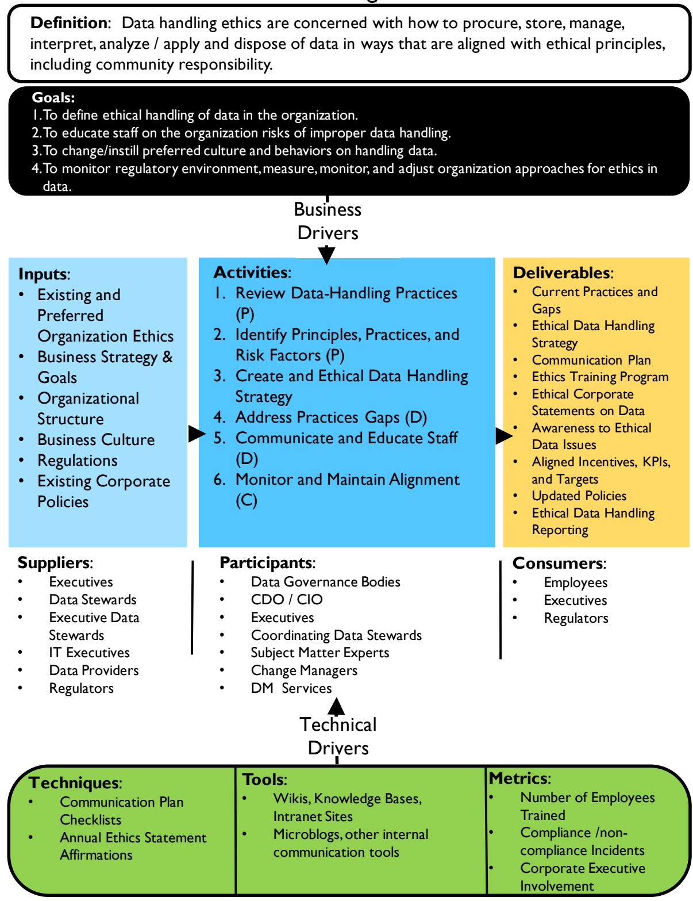
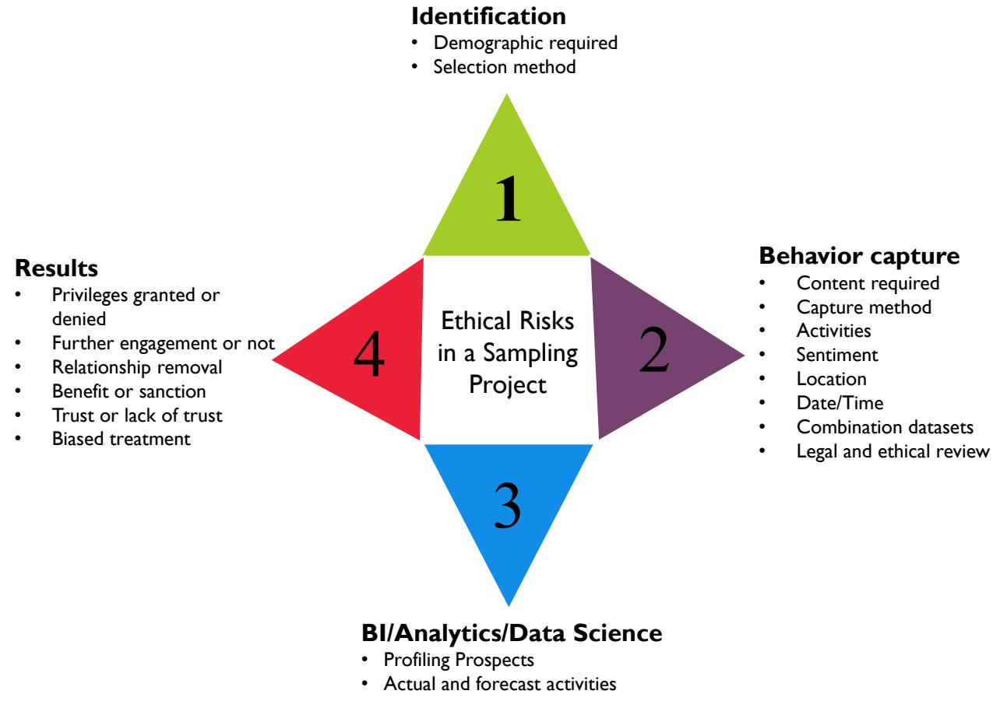

# Ch02 数据处理伦理（Data Handling Ethics）

> **章首学习框**
>
> **学习目标**
> 1. 能讲清伦理与法律的关系：为什么守法只是底线、不是终点
> 2. 能列举 GDPR 七项原则与偏见的五种类型
> 3. 能用伦理风险模型（Ethical Risk Model）评审一个分析项目
>
> **前置知识**：Ch01 §2.3 数据作为组织资产（数据有经济价值）；Ch01 §4.5 数据与风险（监管已把数据放上风险登记册）
>
> **CDGA 考纲关联点**：数据处理伦理三个核心概念（选择高频）/ GDPR 七原则（选择高频）/ 偏见定义与五种类型（选择中频）/ 建立伦理数据文化四步与伦理风险模型（选择中频）

## 本章导读

- Ch01 说数据是资产——但资产是物，数据背后是**人**。数据代表人、被用来做出影响人的决策，这两点决定了数据处理天然附带**伦理义务**。
- 伦理原则不是凭空造的：从生命伦理学的**贝尔蒙特报告（Belmont Report）**借来三原则，再被各国隐私法成文化——OECD 八原则开出三条立法路线（欧盟 GDPR / 加拿大 PIPEDA / 美国 FTC）。
- 不合规数据处理有六类典型手法：时机操纵、误导性可视化、定义不清与无效比较、偏见（Bias）、转换与集成失真、脱敏失效——大数据时代最危险的是**偏见**与**匿名化失效**。
- 伦理不能靠个人自觉，要靠**文化建设四步**——审查现状 → 识别原则、实践与风险 → 战略与路线图 → 采用伦理风险模型，监督责任落在数据治理职能上。

## 1 什么是数据处理伦理（Data Handling Ethics）

先抛一个场景：一家融资担保公司把客户征信数据喂给风控模型，模型给出拒贷建议，客户的人生轨迹就此改变。数据没错、流程合法，但这家公司有没有做错的地方？——这个问题归**数据处理伦理（Data Handling Ethics）**管。

### 1.1 定义与三个核心概念

**定义一句话**：数据处理伦理关心如何以符合伦理原则的方式**获取、存储、管理、使用和处置**数据。伦理（Ethics）本身是建立在是非观念上的行为原则，聚焦公平、尊重、责任、正直、透明与信任。

伦理问题复杂，但全部围绕**三个核心概念**展开：

**① 对人的影响（Impact on People）**

- **场景**：风控模型里一条征信记录错了，客户被拒贷。
- **定义**：数据代表个人的特征，且被用来做出影响人生活的决策。
- **机制**：正因为数据背后是人，组织**有义务管好数据的质量与可靠性**——数据不完整、不准确，本身就是一种伦理失职，不只是技术问题。

**② 滥用的可能（Potential for Misuse）**

- **场景**：催收团队顺手把客户通讯录卖给了第三方营销公司。
- **定义**：滥用数据会对人和组织造成负面影响。
- **机制**：伤害一旦发生很难挽回，所以伦理要求是**事前预防滥用**，而不是事后补救。

**③ 数据的经济价值（Economic Value of Data）**

- **场景**：客户没同意，担保公司能不能把还款行为数据授权给合作方换收益？
- **定义**：数据有经济价值（回引 Ch01 §2.3 数据是资产）。
- **机制**：谁有权访问这份价值、价值归谁，应由**数据所有权的伦理**来决定——资产属性越强，伦理约束越不能缺席。

为什么这三个概念重要：即使数据不直接代表个人（如某个行业的汇总统计），它仍可能被用于影响人的决策。保护数据、管好质量的伦理义务**贯穿数据全生命周期**，从创建到销毁。

🎤 面试考点：被问"数据伦理为什么重要/管什么"时，直接答三个核心概念——**数据影响人**（所以要管质量）、**数据可能被滥用**（所以要事前预防）、**数据有经济价值**（所以要界定所有权与访问权），再补一句"伦理责任贯穿全生命周期"。

### 1.2 语境图：本章全貌一张图

*Figure 12 数据处理伦理语境图*。读法与 Ch01 §6.2.3 完全一致——语境图是每章的阅读钥匙，此处只点关键区域：

- **顶部：定义与目标**。四条目标——定义组织内的伦理数据处理、教育员工认识不当处理的风险、改变与塑造数据处理文化、监控监管环境并调整组织方法。
- **中央：六项活动**。按 PDOC 分类——审查现状（P）、识别原则/实践/风险因素（P）、制定伦理数据处理战略（P）、弥合实践差距（D）、沟通与培训员工（D）、监控与保持对齐（C）。注意：前三项就是本章 §6 文化建设四步的雏形。
- **左侧：输入与供给者**。输入包括组织现有伦理观、业务战略与目标、组织架构、企业文化、法规、现行公司政策；供给者覆盖高管、数据管家（Data Steward）、IT 高管、数据提供方与监管者。
- **右侧：交付物与消费者**。交付物是现状与差距分析、伦理数据处理战略、沟通计划、伦理培训项目、企业伦理声明等；消费者是员工、高管与监管者。
- **下方：参与者、方法与度量**。参与者中**数据治理机构（Data Governance Bodies）与 CDO/CIO** 排在最前——伦理监督的归属在这里已经埋了伏笔；度量指标看"培训人数、合规/违规事件数、高管参与度"。

技术细节不必深抠，记住这张图回答的问题：伦理数据处理**谁来供输入、做什么活动、产出什么、给谁用**。

### 1.3 守法≠免责：法律是底线不是终点

很多组织保护数据的唯一依据是法律法规。DMBOK 指出这是一个**危险假设**，理由分三层：

- **法律只成文化了部分伦理原则**。立法覆盖不全，没写进法律的不等于没有伦理义务。
- **法律永远滞后于数据环境的演化**。组织使用数据的方式几年一变，立法速度跟不上风险的演化速度。
- **两种危险心态要警惕**：一是抱持"传统技术视角（traditional technical perspective）"，声称"我不懂数据，只管系统"；二是认为"只要遵循法律字面（follow the letter of the law）就没有风险"。两者都是把责任推给规则，而不是对人的影响负责。

结论先行一句话：**合规是地板，伦理是天花板**——组织必须主动识别并回应保护受托数据的伦理义务。

### 1.4 业务驱动因素：伦理是竞争优势

为什么要为伦理投入？三条驱动因素层层递进：

- **伦理的本质**：借质量管理之父戴明（W. Edwards Deming）的话说——伦理意味着"**没人在看的时候也做对的事**（doing it right when no one is looking）"。靠监督只能防住被监督的部分。
- **伦理=信任=竞争优势**：伦理处理数据能提升组织及其数据、流程结果的可信度，改善与利益相关者的关系；反之，不当处理会失去声誉与客户。降低数据被员工、客户或合作伙伴滥用的风险，是培育伦理原则的首要业务理由。
- **新角色正在出现**：首席数据官（Chief Data Officer, CDO，回引 Ch01 §4.6）、首席风险官（Chief Risk Officer, CRO）、首席隐私官（Chief Privacy Officer, CPO）、首席分析官（Chief Analytics Officer, CAO）——这些角色的共同使命是通过建立可接受的数据处理实践来控制风险。但责任不止于这些岗位，伦理处理要求**全组织范围**的风险认知与承诺。

📌 记住这个：数据处理伦理 = 三个核心概念（影响人/可被滥用/有经济价值）+ 一个立场（守法只是底线，伦理要求主动建设文化与治理）。

## 2 数据伦理的原则体系（从生命伦理学到数字伦理）

数据伦理不是凭空造出来的。**结论：数据伦理的整套原则，从生命伦理学（bioethics）借来，再向数字场景逐代扩展。**

为什么借医学的？因为生命伦理学同样研究"以人为对象、可能影响人"的活动，其核心是维护**人的尊严（human dignity）**。DMBOK 给出的演进链是：1979 年贝尔蒙特报告 → 2012 年 Menlo 报告 → 2015 年 EDPS 数字伦理意见书。

### 2.1 贝尔蒙特三原则（Belmont Principles）

来源：1979 年美国卫生与人类服务部发布的**贝尔蒙特报告（Belmont Report）**，原为医学研究的伦理规范，可直接改造用于信息管理。

#### 2.1.1 尊重人（Respect for Persons）

- **含义**：人必须被当作有尊严、有自主能力的个体对待。
- **附加要求**：对**自主能力受损者（diminished autonomy）**——如儿童、身心障碍人士——要额外保护其尊严与权利。

数据场景自检三问：

- 系统设计是否限制了用户的**自主权与选择权**？
- 是否考虑过残障人士如何**访问和使用**这些数据？
- 数据处理是否基于**知情且有效的同意（informed, valid consent）**？

#### 2.1.2 行善（Beneficence）

- **第一要素**：不伤害（do not harm）——医学伦理的老原则，数据领域同样成立。
- **第二要素**：利益最大化、伤害最小化。主动识别利益相关者，评估数据处理对他们的后果。

数据场景自检三问：

- 流程是否被设计成**零和博弈**，而不是双赢？
- 处理是否**过度侵入**？有没有风险更小的做法满足同样的业务需求？
- 处理过程是否**缺乏透明**，可能掩盖对人的伤害？

#### 2.1.3 公正（Justice）

- **含义**：对人的**公平与平等对待**。

数据场景自检三问：

- 相似情形下，是否有人或群体被**不平等对待**？
- 流程或算法的产出，是否**不成比例地**利好或伤害某一群体？
- 机器学习训练数据是否在无意中**强化了文化偏见**？——这是算法歧视的源头，§5 偏见一节会展开。

### 2.2 Menlo 报告第四原则：尊重法律与公共利益（Respect for Law and Public Interest）

2012 年美国国土安全部发布**Menlo 报告（Menlo Report）**，把 Belmont 三原则移植到信息与通信技术（ICT）研究，并增补第四条原则——**尊重法律与公共利益**。

一句话记住：前三个原则管"对人"，第四个原则管"对社会"。

### 2.3 EDPS 四大支柱（EDPS Four Pillars）

2015 年，**欧洲数据保护监督局（European Data Protection Supervisor, EDPS）**发布数字伦理意见书，面向大数据处理提出构建伦理信息生态的**四大支柱**：

- **面向未来的监管（Future-oriented regulation）**：法规要有前瞻性，尊重隐私权与数据保护权，不做追在技术后面的马后炮。
- **可问责的控制者（Accountable controllers）**：决定个人信息如何处理的控制者，必须能被问责。
- **隐私意识的工程设计（Privacy conscious engineering）**：把隐私保护做进产品与服务的工程设计里，而不是事后打补丁。
- **被赋权的个人（Empowered individuals）**：让数据主体有能力理解、控制自己的数据。

四大支柱与 Belmont 三原则一脉相承，落点都在人的尊严与自主。EDPS 的核心立场值得记住：**隐私是基本人权；尊严、隐私、自主是数字环境的平台（platform），不是发展的障碍（obstacle）**——它要求创新者换个心态：伦理不是成本，是地基。

数据治理（Data Governance）正是让这些原则落地的工具：它决定谁能在什么情形下对哪些数据做什么。伦理风险要像数据质量一样被识别和管理——这是 §6 的伏笔。

原则讲完了，但原则没有牙齿。**原则如何变成硬约束？答案是成文化为各国隐私法**——这就是 §3 的主线。

📌 记住这个：数据伦理原则来自生命伦理学——Belmont 三原则（尊重人 / 行善 / 公正），Menlo 报告加第四条（尊重法律与公共利益），EDPS 四大支柱（未来监管 / 问责控制者 / 隐私工程设计 / 赋权个人）宣告"隐私是基本人权、尊严是平台不是障碍"。

## 3 隐私法背后的伦理原则（Principles Behind Data Privacy Law）

§2 讲的是伦理原则从哪来；这些原则如何变成**硬约束**？公共政策与法律尝试把伦理原则成文化，但不可能覆盖所有情形——欧盟、加拿大、美国走出了三条不同的成文化路线。这些法律背后的原则，反过来也可作为组织内部政策的现成框架。

### 3.1 立法简史：从"隐私即人权"到 OECD 八原则

隐私法并不新，它的根是"尊重人权"这一伦理要求。先看美国线：

- **1890 年**：美国法学家 Warren 与 Brandeis 首次将隐私与信息隐私描述为**人权**，在普通法中获得保护，并支撑美国宪法中的多项权利。
- **1973 年**：公平信息实践（Fair Information Practice, FIP）守则问世。
- **1974 年**：《美国隐私法》（US Privacy Act）重申信息隐私是受宪法保护的**个人的基本权利**。

再看欧洲线：

- **1950 年**：二战人权惨案之后，《欧洲人权公约》（European Convention of Human Rights）把一般隐私权与**信息隐私权**（个人数据受保护的权利）双双确立为人权，视其为维护人的尊严（Human Dignity）的基础。
- **1980 年**：经济合作与发展组织（OECD）发布《公平信息处理指南与原则》，成为日后欧盟数据保护法的基石。

OECD 的**八项公平信息处理原则（Fair Information Processing Principles）**是这一切的浓缩，记住八个关键词：

| # | 原则 | 一句话 |
|---|------|--------|
| 1 | **收集限制** | 采集个人数据要有边界 |
| 2 | **数据质量** | 数据应保持高质量 |
| 3 | **目的明确** | 采集时须指明特定用途 |
| 4 | **使用限制** | 使用不得超出声明用途 |
| 5 | **安全保障** | 须采取安全防护措施 |
| 6 | **公开透明** | 处理实践应公开透明 |
| 7 | **个人参与** | 个人有权质疑关乎自身数据的准确性 |
| 8 | **问责** | 组织须对遵循原则负责 |

这套八原则后来被欧盟 GDPR 的原则体系所取代并升级。

### 3.2 GDPR 七原则（重点，CDGA 高频）

**《通用数据保护条例》（General Data Protection Regulation, GDPR，2016）**是当前全球最严的个人数据保护法，七条原则必须能背、能举例：

| GDPR 原则 | 一句话释义 |
|-----------|-----------|
| **公平、合法、透明（Fairness, Lawfulness, Transparency）** | 对数据主体的处理须合法、公平且透明 |
| **目的限制（Purpose Limitation）** | 为明确、正当目的采集，不得做不兼容的二次处理 |
| **数据最小化（Data Minimization）** | 够用即可，限于目的所必需的范围 |
| **准确性（Accuracy）** | 保持准确并及时更新，不准确者立即更正或删除 |
| **存储限制（Storage Limitation）** | 可识别形态保存时间不得超出目的所需 |
| **完整性与保密性（Integrity and Confidentiality）** | 以适当技术组织措施防未授权处理与丢失损毁 |
| **问责（Accountability）** | 数据控制者（Data Controller）负责且能**证明**合规 |

与七原则配套的是**数据主体的五项权利**：访问权、更正权（更正不准确数据）、可携带权（Portability）、反对权（对可能造成损害或困扰的处理说不）、删除权（Erasure）。

两个落地细节同样常考：

- **同意要件**：基于同意处理个人数据时，同意必须是一个肯定性动作，且满足四个形容词——**自由给予（freely given）、具体（specific）、知情（informed）、明确（unambiguous）**。默认勾选不算数。
- **设计即隐私（Privacy by Design）**：GDPR 强制要求把隐私保护内嵌进系统设计，并要求有效的治理与文档来**证明**合规，而不只是事后补材料。

🎤 面试考点：被问"GDPR 有哪些原则/你怎么看数据合规"时，答题要点：七原则先报关键词（公平合法透明/目的限制/最小化/准确性/存储限制/完整保密/问责），再挑**数据最小化**举例——"担保风控只采集评估还款能力必需的字段，而不是把客户通讯录全量拉进来"，最后补一句同意四要件或 Privacy by Design 收尾。

### 3.3 PIPEDA 与 FTC：三种监管路线对比

同一套 OECD 伦理原则，落到各国法律时走出了三条路线：

| 路线 | 代表 | 核心机制 | 约束力 |
|------|------|----------|--------|
| **统一强监管** | 欧盟 GDPR（2016） | 统一立法：七原则 + 数据主体权利 + 问责可证 | 强：法定处罚，问责可追责 |
| **法定义务 + 调解执行** | 加拿大《个人信息保护与电子文件法》（PIPEDA） | 成文法定义务适用于一切商业活动中的个人信息处理；联邦隐私专员统一受理投诉 | 弱：专员只做**调解人（ombudsman）**，决定仅为建议，无法律约束力 |
| **行业自律** | 美国联邦贸易委员会（FTC）2012 报告 | 企业按最佳实践**自建**隐私项目，即 Privacy by Design | 弱：推荐性质，靠企业自律 |

FTC 报告的**五项隐私项目标准**值得记住（同样源于 OECD 原则）：

1. **告知（Notice / Awareness）**：采集前向消费者披露信息处理实践。
2. **选择（Choice / Consent）**：超出原用途的使用须给消费者选择权。
3. **访问（Access / Participation）**：消费者可查看并质疑自身数据的准确性。
4. **完整与安全（Integrity / Security）**：确保数据准确、防未授权使用。
5. **执行与救济（Enforcement / Redress）**：对不合规行为要有可靠的惩戒机制。

三条路线对比的启示：**原则趋同、力度不同**。欧盟把伦理原则变成带牙齿的法律；加拿大立了法但执法靠调解；美国则寄望行业自律。

### 3.4 全球趋势

全球立法整体趋严，普遍跟随欧盟设定的标准。各国对**数据跨境流动**施加不同限制——即便是跨国组织，内部分享数据也有法律边界。组织必须有政策与指引，让员工既能守法、又能在组织风险偏好内用数。中国的相关法规体系留待 Ch07、Ch17 展开，此处按下不表。

📌 记住这个：隐私法的伦理根是"隐私即人权"（1890→1973→1974 美国线，1950→1980 欧洲线汇入 OECD 八原则）；GDPR 七原则+五项数据主体权利+同意四要件是高频考点；同一套原则落地为欧盟强监管、加拿大调解式、美国自律式三条路线。

## 4 网络数据的伦理议题（Online Data in an Ethical Context）

法律成文化的速度跟不上网络，于是冒出四个仍在争论的议题（一笔带过）：

- **数据所有权**：数据经纪人（Data Broker）把碎片数据拼成当事人不知情的**深度画像**。
- **被遗忘权（Right to be Forgotten）**：要求从网上抹掉关于自己的信息，本质是数据保留问题。
- **身份权**：有权拥有唯一且正确的身份，也有权选择匿名身份。
- **网络言论自由**：表达观点与霸凌、煽动之间的边界。

📌 记住这个：网络数据四议题——所有权、被遗忘权、身份权、言论自由，都还没被法律完全收编。

## 5 不合规数据处理的风险（Risks of Unethical Data Handling Practices）

§4 的四个议题法律还没完全收编；即便在法律已覆盖的日常数据处理里，也藏着一批典型的不合规手法。

1954 年的《如何用统计数字撒谎》（How to Lie with Statistics）早就揭示：精挑细选数据、操纵刻度、省略数据点，就能造出"看似客观"的谎言。这些手法今天依然有效。

所以，伦理的数据处理不是"不违法就行"，而是一项**积极义务**：底线是**真实**——不用数据撒谎误导；前提是**透明**——公开数据的来源、用途和处理意图。下面六类不合规手法，就是对这两条义务的典型破坏。

### 5.1 时机操纵（Timing）

**结论：通过选择"何时计入"数据，就能撒谎。**

经典案例是尾盘操纵（market timing）：在收盘前集中交易，人为抬高收盘价，让股票看起来比实际更值钱。这是**违法行为**。

治理启示：**BI 人员往往是异常的第一发现者**。他们复盘交易模式、监控规则与告警，一旦发现异常，有义务上报治理或管理层——"看见了装没看见"本身就是不合规。

### 5.2 误导性可视化（Misleading Visualizations）

**结论：图表可以诚实地画，也可以故意骗人。**

三种常见手法：

- **改坐标轴**：缩放刻度，让趋势线看起来更好或更糟。
- **漏数据点**：悄悄删掉不支持结论的点。
- **违反视觉惯例**：饼图百分比加起来不等于 100%，或对比两件事却不交代二者的关系。

报表做得越漂亮，越要问一句：坐标轴从几开始？（可视化的正面展开见 Ch11。）

### 5.3 定义不清与无效比较（Unclear Definitions or Invalid Comparisons）

**结论：统计口径不清，比较就无效——无论故意还是笨拙，都是不合规的数据使用。**

看一个真实案例：某美国媒体用 2011 年普查数据称"1.086 亿人领福利，全职工作者只有 1.017 亿"，暗示领福利的人比干活的人还多。问题出在**口径错位**：

- **领福利人数**：按**家庭**统计——家里有一人领福利，全家都算进去。
- **全职工作人数**：按**个人**统计——只算本人有全职工作的。

家庭口径天然大于个人口径，两个数字根本没有可比性。伦理的做法是**给出语境**：明确定义被统计的人群和"领福利"的含义，缺一角的呈现会暗示数据并不支持的结论。

另两个统计陷阱：

- **统计平滑（smoothing）**：对一段时间的数字做平滑处理，可以完全改变人对趋势的感知。
- **数据挖掘窥探（Data Mining Snooping）**：对数据集做穷尽式相关性挖掘，等于过度训练模型。按"统计显著性"的脾气，总会挖出几个**看似显著、实则随机**的结果，外行很容易被唬住。金融与医疗领域尤其常见。

📌 记住这个：无效比较的核心是口径错位——比较前先对齐统计口径（家庭 vs 个人），并警惕穷尽挖掘产生的伪显著。

### 5.4 偏见（Bias）

**结论：偏见在数据全生命周期都能引入，且会给结果披上"中立客观"的外衣——大规模数据处理中它最危险。**

先分清两种含义：

- **日常含义**：倾向性、无根据的预判（个人层面的偏见）。
- **统计含义**：对期望值的**系统性偏离**，通常由抽样或数据选择中的系统性错误引入。

偏见在数据生命周期的**四个点**上进入：数据**收集/创建**时、**选样**进入分析时、**分析方法**本身、分析**结果呈现**时。

原书列出五种偏见类型：

| # | 类型 | 一句话 |
|---|------|--------|
| 1 | 为预设结论收集数据 | 分析师迫于压力，只为凑出既定结论而采集数据 |
| 2 | 偏用已收集数据 | 数据本身没问题，但只取用支持预定方案的部分，不顺眼的就丢弃 |
| 3 | 直觉搜索（Hunch and Search） | 先有直觉，只用印证直觉的数据，无视数据揭示的其他可能 |
| 4 | 抽样方法偏见 | 人选样几乎必有偏，要用统计工具选样本并保证样本量充足 |
| 5 | 文化与语境偏见 | 偏见常植根于文化和语境，须跳出自身语境才能中立审视 |

但注意一个关键区分：**并非所有偏见都要消除**。

- **合理偏见**：业务分析中把"不再合作的差客户"从样本中剔除，是很多分析场景的基础。可以保留，但分析师**必须把人群筛选标准文档化**。
- **高危偏见**：用预测算法给个人打"犯罪风险"分、预测性执法往特定街区派警力——直接触碰公正原则，必须保证**算法透明与问责**，并主动校正训练数据中的偏见。

🎤 面试考点：被问"偏见有哪些类型 / 如何避免算法歧视"，先背五种类型（预设结论收集 / 偏用已收集数据 / 直觉搜索 / 抽样偏见 / 文化语境偏见），再落到融资担保场景：如果用历史审批数据训练风控模型，而历史审批本身对某类客群存在歧视性拒贷，模型会**学习并放大这种歧视**——训练数据强化了既有偏见。应对：审查训练集构成、文档化样本筛选标准、对高风险应用要求算法透明与问责。

### 5.5 数据转换与集成的伦理风险（Transforming and Integrating Data）

**结论：数据在系统间流转时会被改变；集成不当，风险从"不合规"升级为"违法"。**

四类具体问题：

- **血缘不明**：不知道数据从哪来、途中被改过什么，就无法证明数据代表它声称代表的东西。
- **质量差**：没有明确可测的质量标准和实测确认，组织无法为数据背书，下游使用者会被置于风险之中。
- **元数据不可靠**：数据消费者依赖一致的元素定义、来源文档和血缘记录；数据跨组织、跨境流动时，元数据必须**标记来源、所有者和保护要求**。
- **无修复变更记录**：数据修复即使出于好意，也可能违法；任何修复都必须走**正式、可审计的变更控制流程**。

血缘、元数据的概念回引 Ch01（管理数据需要元数据），技术展开见 Ch08 与 Ch13。

### 5.6 数据混淆与脱敏（Data Obfuscation / Redaction）

**结论：脱敏是必要手段，但单靠脱敏不足以保护数据——下游的关联分析可能把匿名打回原形。**

三种常用手段：

| 手段 | 做法 | 典型场景 |
|------|------|----------|
| **数据聚合（Aggregation）** | 按维度汇总、去掉标识信息，保留分析价值 | 按地理区域聚合，不暴露个人身份信息（PII） |
| **数据标记（Marking）** | 标注敏感度等级（秘密/机密/个人等），控制发布范围 | 限定发布给特定社区、供应商甚至特定国家 |
| **数据掩码（Masking）** | 操作员只录入应答、看不见原始数据，答对才放行流程 | 外包呼叫中心、只能接触部分信息的分包商 |

核心警告：**大数据环境下，匿名化会失效**。数据集足够大时，多个来源的数据可以交叉组合，把已匿名的个体**重新识别**出来——即便每个输入集都脱过敏。这就是"组合攻击"的直觉：单看每份数据都无害，拼起来就能定位到具体的人。

因此，数据入湖的第一件事是**扫描敏感数据并施加公认的保护方法**；但技术手段仍不够，**强有力的治理与伦理承诺才是最后防线**（详见 Ch14）。

🎤 面试考点：被问"匿名化为什么会失效"，答组合攻击原理——大数据集可以跨来源关联，把匿名记录重新匹配到具体个人；所以脱敏只是第一道闸，数据入湖要先扫描敏感数据，最终靠治理和伦理承诺兜底。融资担保场景同理：报送给外部的"脱敏"客户数据，若与公开工商数据、征信片段拼接，仍可能还原出具体企业。

📌 记住这个：不合规六手法——时机、误导可视化、定义不清、偏见、集成失真、脱敏失效；偏见看生命周期四引入点，脱敏警惕大数据重识别。

## 6 建立伦理数据文化（Establishing an Ethical Data Culture）

前面五节讲了原则、法律和六类不合规手法——知道坑在哪还不够，组织层面必须系统性地防。伦理不能靠个人自觉，要靠**文化建设**。

建设伦理数据文化（Ethical Data Culture）分**四步走**：

1. **审查现状**：摸清现有实践与伦理驱动的连接度。
2. **识别原则、实践与风险因素**：把"该做什么"和"怕出什么错"对齐。
3. **制定战略与路线图**：把期望行为写进政策、守则、培训计划。
4. **采用伦理风险模型**：给每个分析项目配一把评审标尺。

两个前提先讲清：

- **强领导力**：与所有治理和变革举措一样，没有高层背书推不动。
- **组织变革管理（OCM）**：文化建设本质是变革，要走正式的 OCM 流程，Ch17 专章讲方法，这里先记下结论。

另外，伦理文化不止于"有守则"。员工发现不伦理行为或伦理风险时，必须能**提出问题或叫停流程而不必担心报复**——清晰的沟通渠道、治理控制和升级路径（escalation path）是文化的实体部分。

### 6.1 第一步：审查现状（Review Current State）

改进的第一步是理解现状。这一步要回答两个问题：

- **连接度**：现有数据处理实践与伦理、合规驱动之间，是直接且明确的连接，还是各干各的？
- **认知度**：员工是否理解现有实践的伦理含义——它们如何构建和维系客户、伙伴及其他利益相关者的信任？

**交付物只有一份**：一份文档，写明组织在**数据全生命周期**（采集、使用、监督，含数据共享）中应遵循的伦理原则。注意关键词是"全生命周期"——不是只管采集端，共享和归档销毁同样覆盖。

### 6.2 第二步：识别原则、实践与风险因素（Identify Principles, Practices and Risk Factors）

形式化伦理实践的目的只有一个：**降低数据被滥用、伤害利益相关者的风险**。这一步的核心工作是把四个概念串成一条链：

> **原则（Principles）→ 风险（Risks）→ 实践（Practices）→ 控制（Controls）**

原则指导；风险是"不遵守原则会发生的坏事"；实践是"规避风险该怎么做"；控制是"确保实践被执行的机制"。用原书的医疗数据例子完整走一遍：

| 环节 | 医疗数据访问的例子 |
|------|------------------|
| **指导原则** | 个人对其健康信息享有隐私权，患者健康数据只能被诊疗所需的授权人员访问 |
| **风险** | 若访问面过宽，个人健康信息可能变成公开知识，隐私权被损害 |
| **实践** | 仅允许医生和护士访问，且仅限提供诊疗的目的 |
| **控制** | 每年审查一次所有健康信息系统的用户权限，确保只有需要的人有权限 |

链条之外还有两类输入：

- **行业特定风险**：通用原则（如保护个人隐私）之外，金融信息、健康信息等有其行业特有的保护要求。
- **组织特定风险**：技术足迹、员工流动率、客户数据采集方式等，都会带来各组织独有的风险点。跨国运营的组织还须了解各运营国法律背后的伦理原则及国家间的协议。

📌 记住这个：伦理落地靠一条链——原则定方向，风险说后果，实践给做法，控制保执行。

### 6.3 第三步：制定伦理数据处理战略与路线图（Strategy and Roadmap）

审查现状、确定原则之后，把期望行为正式化。战略要同时表达**伦理原则**和**期望行为**，载体是价值观声明与伦理行为守则。七个组件：

| # | 组件 | 要点 |
|---|------|------|
| 1 | **价值观声明（Values Statements）** | 组织相信什么——真实、公平、公正等，为伦理数据处理提供框架 |
| 2 | **伦理数据处理原则** | 如何应对数据带来的挑战（如尊重个人隐私权）；汇总为**伦理守则（Code of Ethics）**，由伦理政策支撑 |
| 3 | **合规框架（Compliance Framework）** | 梳理驱动组织义务的因素；受地域与行业影响 |
| 4 | **风险评估（Risk Assessments）** | 识别特定问题发生的可能性与影响，用于排定缓解行动的优先级 |
| 5 | **培训与沟通** | 培训覆盖守则解读，员工须签署确认知悉；要求**年度伦理声明确认（annual ethics statement affirmation）**；沟通要触达全员 |
| 6 | **路线图（Roadmap）** | 含管理层可批准的时间线与活动：培训沟通计划执行、现有实践差距识别与补救、风险缓解、监控计划；覆盖全部适用法律与文化因素 |
| 7 | **审计与监控方法** | 守则靠培训强化，活动靠监控验证——确保实际执行与伦理原则一致 |

一句话记法：先立价值观，再写守则政策，摸清合规义务，评估风险排优先级，培训签署到人，排期落地，最后靠审计监控收口。

### 6.4 第四步：采用社会责任的伦理风险模型（Adopt a Socially Responsible Ethical Risk Model）

**为什么 BI、分析和数据科学项目需要专门的风险模型？** 因为这些项目处理的数据描述的是**活生生的人**，且覆盖四个维度：

- **是谁**：原籍国、种族、民族、宗教特征。
- **做什么**：政治、社会，乃至潜在的犯罪活动。
- **在哪、有什么**：住址、财产、购物记录、与谁通话短信邮件。
- **被如何对待**：分析结论本身——评分、偏好追踪会给人贴上"优待或不优待"的标签，影响其后续获得的服务。

这类数据一旦被滥用，直接违背尊重人、行善、公正三原则（见 §2.1）。而且组织有**不伤害的社会责任**：伦理视角要超出雇主边界，看到对更广泛社区的影响。

原书给了个扎心的例子：组织设定"坏客户"标准、停止与其做生意，听起来是正常商业决策；但如果该组织在某地区**垄断了基本服务**（如能源、供水），被剔除的个人将无处获得这项服务——一个商业决策变成了伤害。垄断辖区内，法律可能直接禁止这种剔除。

**伦理风险模型（Ethical Risk Model）**怎么用？任何使用个人数据的项目，在立项时沿四个箭头逐一评估伦理风险：

*Figure 13 抽样项目的伦理风险模型（Ethical Risk Model for Sampling Projects）。中心是"抽样项目中的伦理风险"，四个箭头各代表一个评估环节：*

- **箭头 1 识别（Identification，向上）**：研究人群怎么选？——要求哪些人口统计字段？选样方法是什么？
- **箭头 2 行为捕获（Behavior Capture，向右）**：数据怎么采？——采集哪些内容、什么方法？是否涉及活动、情绪、位置、时间戳？是否做数据集组合？是否经过法律与伦理审查？
- **箭头 3 BI/分析/数据科学（向下）**：分析活动聚焦什么？——刻画潜在客户画像（profiling prospects）、分析实际与预测行为。
- **箭头 4 结果（Results，向左）**：结果触达谁、产生什么后果？——授予或拒绝特权、是否继续往来、解除关系、利益或制裁、信任或不信任、有偏见的对待。

每个环节都要评估对客户或公众的**潜在负面影响**。评估结论既决定**项目做不做**，也决定**怎么做**：数据匿名化、剔除文件中的私密信息、收紧并确认文件安全、与法务一起复核本地及适用的隐私法。

最后两点组织保障：

- **保护吹哨人（Whistleblower）**：分析项目复杂，伦理挑战不易被看见；自动化监控不足以兜底，看见风险并提出的人必须受到保护、免受报复。
- **分析师要主动反思偏见**：DAMA 鼓励数据专业人士表明职业立场，向可能没意识到风险的管理层**陈明特定数据用途的含义**。

🎤 面试考点：被问"如何避免算法歧视/数据滥用"时，答伦理风险模型的四个环节——选人群（Identification）、采数据（Behavior Capture）、做分析（BI/Analytics/Data Science）、发结果（Results），每个环节评估对客户和公众的负面影响，结论决定项目做不做与怎么做；再补一句"保护吹哨人，分析师有向管理层陈明风险的职业义务"。

### 6.5 数据伦理与治理（Data Ethics and Governance）

伦理监督是**双责任**：

- **数据治理（Data Governance）**：为数据处理实践**定标准、定政策、做监督**。对 BI、分析、数据科学项目提出的计划与决策负有**特别审查义务**——这是对 6.4 风险模型的治理承接。
- **法务（Legal Counsel）**：与治理一起跟进法律变化，确保员工知悉义务，降低伦理失当风险。

员工侧的三项正当期待：被公平对待、举报可能违规时受保护、个人生活不受干涉。

最后一个认证知识点：**CDMP 认证（Certified Data Management Professional）**要求数据管理专业人士签署正式伦理守则，其中包含一条超越雇主的义务——**为了全社会的利益而伦理地处理数据**。这呼应 6.4 的"社会责任"：数据专业人士的伦理义务不只对公司，也对公众。

📌 记住这个：伦理文化四步——审查现状、识别原则实践风险、定战略路线图、用伦理风险模型评审项目；监督归数据治理与法务双责任，CDMP 认证以签署伦理守则为门槛。

## 7 落地视角

中小公司不必照搬 §6 的全套方法论。裁剪原则一句话：不新建机构，把伦理嵌进现有治理动作。

**裁剪三招**：

- **不设独立伦理委员会**：把伦理检查并入数据治理例会，作为固定议题。伦理监督本就归数据治理与法务双责任（§6.5）；中小公司法务常缺位，治理例会是唯一抓手。
- **第一刀切在立项评审**：每个分析项目立项时，用伦理风险模型（Ethical Risk Model）的四箭头问四个问题——研究人群怎么选？数据怎么捕获？分析聚焦什么？结果触达谁？（§6.4）四问答不清，项目不上马。
- **报送口径先文档化**：监管报送数据的统计口径写成文档，谁改口径谁留痕。融资担保行业报给监管的每个数字背后都是口径选择，口径不清本身就是伦理风险（§5.3）。

**三个常见坑**：

- **把隐私合规当一次性项目**：合规验收完就撒手。数据环境持续演化、法律持续滞后，伦理义务是持续义务（§1.3）。
- **脱敏后放任下游任意关联**：脱敏只在交付那一刻有效；大数据集可被重新识别（Re-identification），下游随意关联其他数据集，脱敏前功尽弃（§5.6）。
- **用"业务需要"绕开最小化采集**："先采了再说"直接违反数据最小化（Data Minimization）原则（§3.2）。业务需要必须被证明，不能当万能挡箭牌。

📌 记住这个：中小公司伦理落地 = 并入治理例会 + 立项四问 + 报送口径文档化；三个坑——合规当一次性项目、脱敏后放任关联、拿"业务需要"绕开最小化。

## 8 常见误区与易混淆概念辨析

| 易混淆对 | 区别一句话 |
|----------|-----------|
| 守法合规 vs 伦理免责 | 法律只成文化了部分伦理原则，且永远滞后于数据环境演化；「守法即无风险」是危险假设（§1.3） |
| 伦理 vs 合规 | 合规是底线义务，回答"必须做什么"；伦理是积极义务，回答"应该做什么"，覆盖法律管不到的地带（§1.3、§5） |
| 偏见（统计意义）vs 偏见（个人歧视） | 统计偏见是系统性偏离期望值，源于抽样与数据选择，可用统计工具控制；个人偏见是无理由的预判，要靠文化与语境自觉（§5.4） |
| 数据聚合 vs 数据标记 vs 数据掩码 | 聚合靠合并维度消除个体；标记靠敏感度分级控制发布范围；掩码让操作员只输应答、不见数据。三者都是脱敏手段，可组合使用（§5.6） |
| 被遗忘权 vs 删除权 | 删除权（Right to Erasure）是 GDPR 赋予数据主体的一般性权利；被遗忘权（Right to be Forgotten）特指从网络上抹除个人信息、调整网络声誉，属数据留存实践（§3.2、§4） |

## 9 本章与其他章节关联

- **Ch03 数据治理**：伦理监督归属数据治理职能，本章 §6.5 的治理双责任在那里全面展开。
- **Ch07 数据安全**：脱敏、掩码、访问控制的技术实现，是 §5.6 数据混淆手段的落地章节。
- **Ch08 数据集成与互操作**：数据血缘与集成规则的方法论，回应 §5.5 集成转换的伦理风险。
- **Ch11 数据仓库与商务智能**：报表与可视化的规范在那里展开，§5.2 误导性可视化是其反面教材。
- **Ch13 数据质量**：准确性、及时性等质量维度是"数据可信"的度量手段（§5 总起）。
- **Ch14 大数据与数据科学**：大数据集重识别风险与匿名化失效的完整讨论（§5.6）。
- **Ch17 组织变革管理**：伦理文化建设四步需要正式的组织变革管理（OCM）过程支撑（§6 总起）。

## 10 本章要点回顾

1. **伦理三核心**：数据代表人、可能被滥用、本身有经济价值——守法只是底线不是终点，法律永远滞后于数据环境演化。
2. **原则有传承**：贝尔蒙特三原则（尊重人、行善、公正）→ OECD 八项公平信息处理原则 → GDPR 七原则；伦理先成为原则，再成文化为法律。
3. **六类坑要认全**：时机操纵、误导可视化、定义不清、偏见、集成失真、脱敏失效；大数据时代偏见与匿名化失效最危险。
4. **伦理靠文化不靠自觉**：审查现状 → 识别原则/实践/风险 → 战略与路线图 → 用伦理风险模型评审每个分析项目，四步走完才算闭环。
5. **监督归治理**：数据伦理监督落在数据治理与法务双责任上；CDMP 认证要求签署职业伦理守则，责任超越雇主、面向整个社会。
