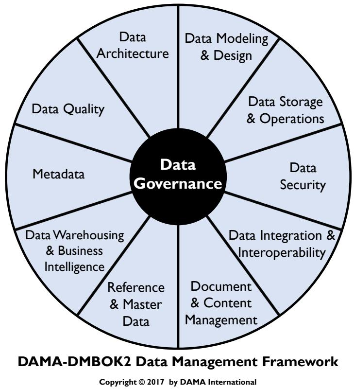
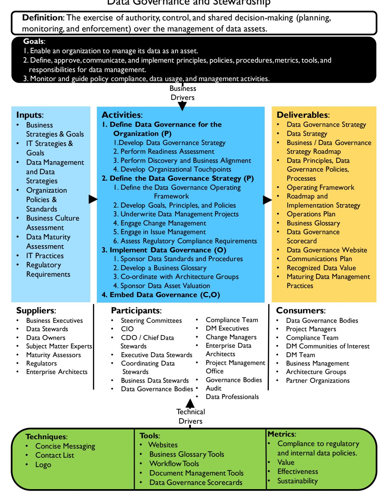
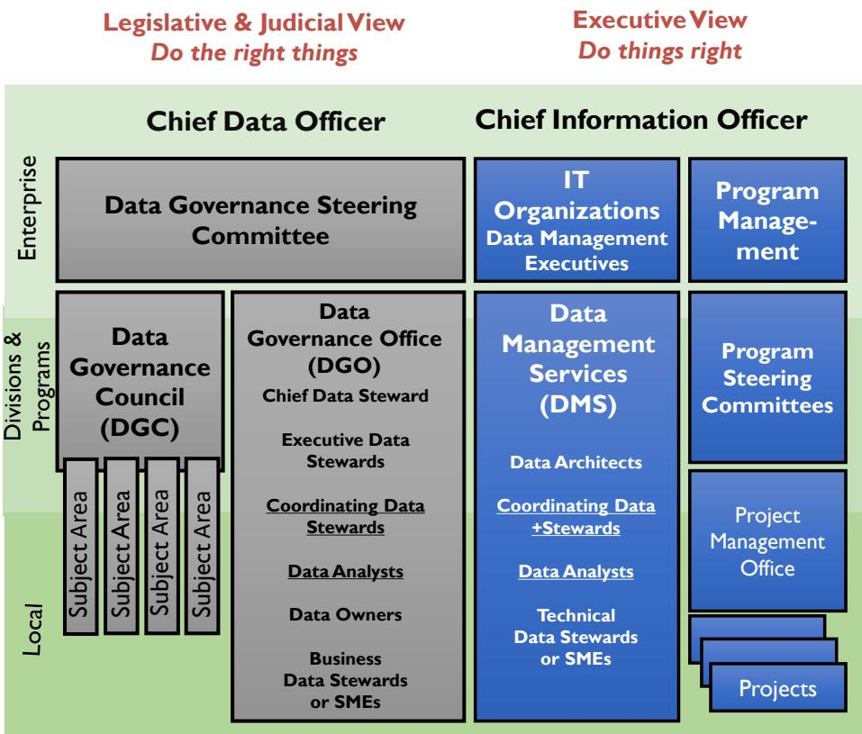
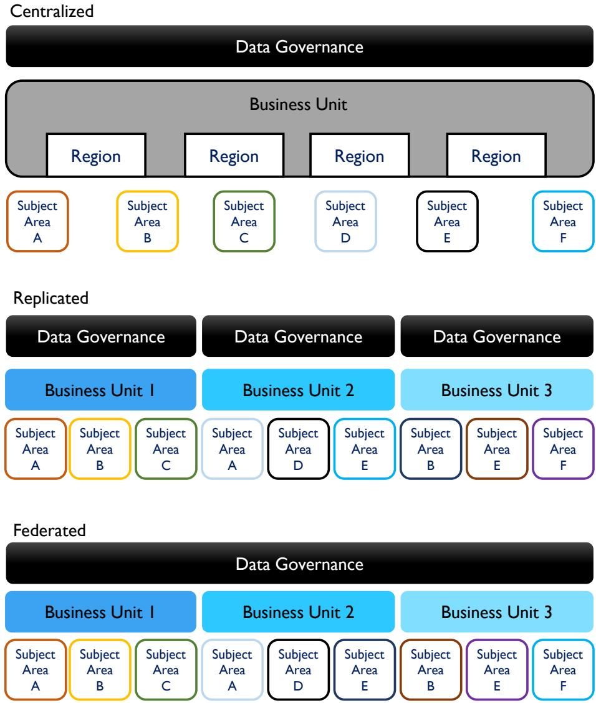
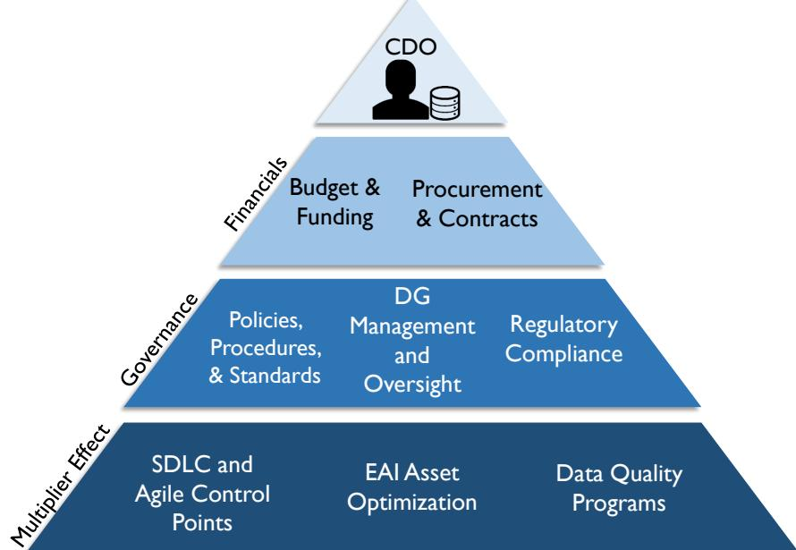
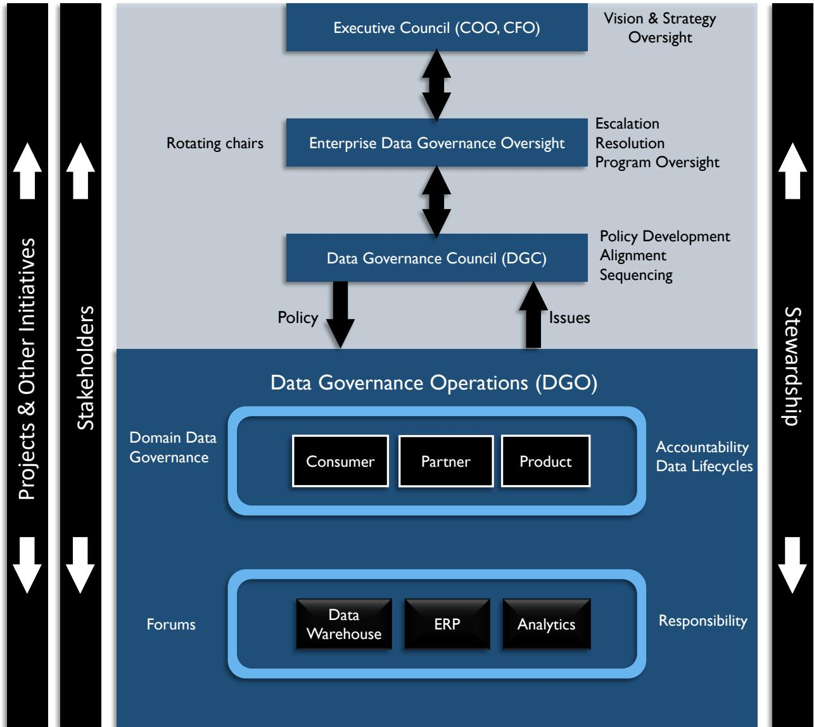
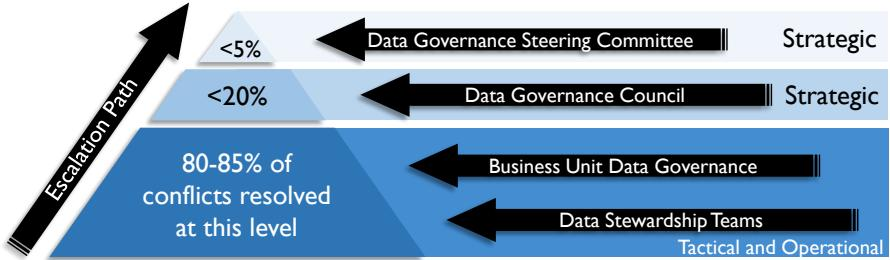

# Ch03 数据治理（Data Governance）

> 核心结论：数据治理对数据资产管理行使权力与控制。
> 核心是明确决策权、责任与行为约束，而非包办数据工作。

## 章首学习框

**学习目标**

- 说清数据治理的定义、范围与边界。
- 解释治理的业务驱动、三项特征与六项原则。
- 区分三种运行模式及关键治理角色。
- 能把治理机制映射到融资担保业务。

**前置知识**

- 回引 **Ch01**：数据是资产，管理覆盖全生命周期。
- 回引 **Ch01**：数据管理包含多个知识领域。
- 回引 **Ch02**：伦理要求应进入数据决策与行为规范。

**CDGA 考纲关联**

- 高频掌握：定义、语境图、治理边界。
- 高频掌握：三项特征、六项原则、业务驱动。
- 高频掌握：组织模式、角色、制度与实施路径。
- 高频掌握：业务术语表与三类治理指标。

## 本章导读

一家融资担保公司出现三个担保余额。它们是教学示例，不是监管口径。

| 使用方 | 数值 | 来源与口径 |
|---|---:|---|
| 担保系统 | 1.00 亿元 | 合同原始担保金额 |
| 风控模型 | 0.80 亿元 | 扣除已解保金额 |
| 监管报表 | 0.90 亿元 | 一份手工调整表，调整依据未留痕 |

差异同时来自口径、来源和无痕调整。报送期限却不会等待。本章将用同一案例跑通决策、制度、整改和复盘。

本章沿这条问题链展开：

1. **治理是什么**：谁有权统一口径并监督执行。
2. **谁来治理**：业务与技术如何分担责任。
3. **靠什么治理**：如何把原则变成制度和标准。
4. **如何实施与持续**：如何嵌入流程并度量成效。
5. **如何落地**：如何服务报送、征信与风控场景。

## 1 治理是什么（What is Data Governance）

### 1.1 从“三个余额”理解决策权

**先统一决策权，再统一数据。**

上述问题不能只靠修接口解决。至少要回答四个问题：

- 哪个系统是权威来源？
- 哪个口径用于监管报送？
- 谁批准余额口径的变更？
- 出现差异后谁监督整改？

这些问题都属于数据治理。它们指向决策权、责任和行为约束。

技术团队可以修正数据。但权威口径不能只由技术团队决定。

### 1.2 数据治理是行使权力与控制

**数据治理，是对数据资产管理行使权力与控制。**

数据治理（Data Governance，DG）包括三项基本动作：

- **规划（Planning）**：确定规则、责任与目标。
- **监督（Monitoring）**：检查数据活动与结果。
- **执行约束（Enforcement）**：推动规则落实与纠偏。

定义中的重点是“如何决策”。它还包括人员应如何行动，流程应如何运行。

所有组织都会做数据决策。正式治理只是让决策更主动、更清晰、更一致。

以担保余额为例：

- 治理确定权威来源和报送口径。
- 数据管理完成采集、校验与修正。
- 治理再检查结果并推动整改。

#### 1.2.1 治理通常覆盖八项范围

| 范围 | 核心任务 | 融资担保例子 |
|---|---|---|
| **战略（Strategy）** | 制定并推动数据与治理战略 | 让数据战略服务普惠担保业务 |
| **政策（Policy）** | 制定并执行数据管理政策 | 明确客户征信的访问与使用要求 |
| **标准与质量（Standards and Quality）** | 制定并执行质量与架构标准 | 统一客户标识和余额质量标准 |
| **监督（Oversight）** | 观察、审计并纠正关键问题 | 检查报送数据是否遵守口径 |
| **合规（Compliance）** | 满足数据相关监管要求 | 保证监管报送完整且可追溯 |
| **问题管理（Issue Management）** | 识别、升级并解决数据问题 | 处理余额差异与责任争议 |
| **数据管理项目（Data Management Projects）** | 赞助数据管理改进项目 | 推动客户主数据改进 |
| **数据资产估值（Data Asset Valuation）** | 统一衡量数据的业务价值 | 评估风控历史数据的价值 |

八项范围不必同时铺开。实际范围应由组织问题决定。

**图 3-1：数据治理位于车轮图中心。**

外圈是各数据管理知识领域。中心的数据治理为它们提供共同方向。

这张图表达的是指导关系：

- 治理指导架构、质量、安全等领域。
- 治理不等于这些领域工作的总和。
- 各领域执行具体的数据管理活动。
- 治理确保这些活动遵循政策与实践。

例如，安全团队实施访问控制。治理则明确客户征信数据的访问原则，并监督控制是否有效。

### 1.3 语境图展示治理如何形成闭环

**图 3-2：业务与技术驱动，共同进入治理活动。**

语境图可按“输入—活动—交付物”阅读。

| 部分 | 图中含义 | 阅读重点 |
|---|---|---|
| **输入（Inputs）** | 业务战略、IT 战略、现有制度、文化与监管要求等 | 治理不能脱离组织现状 |
| **活动（Activities）** | 定义治理、制定战略、实施治理、嵌入治理 | 治理从设计走向日常运行 |
| **交付物（Deliverables）** | 战略、政策、运行框架、路线图、术语表、记分卡等 | 治理必须留下可检查成果 |

图中字母表示活动属性：

- **P（Planning）**：规划。
- **C（Control）**：控制。
- **D（Development）**：开发。
- **O（Operations）**：运营。

本图主要使用 P、C、O。它说明治理既要规划，也要控制和持续运营。

图的下方补充三类支撑：

- **参与者（Participants）**：治理机构、业务与技术角色等。
- **供给者（Suppliers）**：高管、数据所有者、监管者等提供输入。
- **消费者（Consumers）**：项目、合规、业务与管理团队等使用成果。

底部还列出方法、工具与指标。其中指标关注合规、价值、有效性与可持续性。

放到融资担保场景，这条链路是：

**监管与业务要求 → 明确余额治理规则 → 形成口径、责任和检查机制 → 报送与风控共同使用。**

因此，语境图不是组织架构图。它描述治理工作如何运转。

### 1.4 治理、数据管理与 IT 治理不能混同

**治理负责监督，管理负责执行。**

这是一种职责分离。类似审计监督财务流程，但不代替财务部门记账。

| 类型 | 决策焦点 | 典型问题 |
|---|---|---|
| **数据治理** | 数据资产应如何被管理 | 谁批准客户口径与使用规则？ |
| **数据管理** | 如何执行数据工作以实现目标 | 如何采集、存储、整合并修正数据？ |
| **IT 治理** | IT 投资、应用与项目组合 | 是否建设新平台，投资优先级如何？ |

数据治理与 IT 治理需要协同。但二者对象不同。

IT 治理关注硬件、软件与技术架构。数据治理专注数据及数据资产管理。

例如，采购风控平台属于 IT 投资决策。平台内客户数据的定义、权限与质量责任，仍需数据治理明确。

🎤 **面试考点**：常被问“数据治理与数据管理有何区别”。回答先给“监督与执行分离”，再举“治理定余额口径，管理修余额数据”的例子。

### 1.5 业务驱动决定治理是否值得做

**治理不是目的，解决业务问题才是目的。**

治理必须直接对齐组织战略。越能解决真实问题，越容易获得支持并改变行为。

常见起点包括监管合规与数据分析。也可能是重大数据问题或主数据建设。

例如，公司先建设客户主数据。随后发现客户口径无人拍板，才认识到必须先建立治理。

#### 1.5.1 降低风险

- **一般风险管理**：控制数据带来的财务与声誉风险。
- **数据安全**：保护数据的完整、可用、可审计与安全。
- **隐私保护**：控制私密信息和个人身份信息的使用。

融资担保中，错误代偿数据可能扭曲风险判断。征信数据滥用则可能带来合规与声誉损失。

#### 1.5.2 改进流程

- **监管合规**：一致、高效地响应监管要求。
- **数据质量改进**：让数据更可靠，支持业务绩效。
- **元数据管理**：统一术语，并帮助定位和理解数据。
- **研发效率提升**：在研发流程中前置处理数据问题。
- **供应商管理**：控制采购、外包等合同中的数据责任。

例如，监管报表反复返工，不只是质量问题。背后可能缺少统一口径、明确责任和变更控制。

因此，立项理由不应只是“成立治理组织”。更好的理由是减少报送差错、降低征信风险、提升风控效率。

### 1.6 三项特征保证有效，六项原则指导建设

**总目标是把数据作为资产管理。**

治理为此提供原则、政策、流程、框架、指标与监督，并指导各层级的数据管理活动。

#### 1.6.1 三项特征：可持续、嵌入式、可度量

| 特征 | 核心要求 | 反例 |
|---|---|---|
| **可持续（Sustainable）** | 依靠业务领导、赞助与所有权长期运行 | 项目验收后治理随即停止 |
| **嵌入式（Embedded）** | 融入研发、分析、主数据与风险管理 | 在现有流程外增加孤立审批 |
| **可度量（Measured）** | 明确基线，并度量改进与财务影响 | 只统计开会和发文数量 |

可持续不等于建立庞大部门。关键是行为改变能够延续。

嵌入式强调治理成为工作的一部分。可度量则要求先知道起点，再证明改善。

#### 1.6.2 六项原则：从领导支持到原则化运行

| 原则 | 核心含义 | 融资担保例子 |
|---|---|---|
| **领导与战略（Leadership and Strategy）** | 领导承诺，数据战略对齐业务战略 | 高管推动报送口径统一 |
| **业务驱动（Business-driven）** | 治理是业务工程，也约束涉数 IT 决策 | 由业务风险而非技术便利定规则 |
| **共同责任（Shared Responsibility）** | 业务管家与技术数据人员共同负责 | 业务定口径，技术实现校验 |
| **多层次（Multi-layered）** | 企业、局部及中间层共同治理 | 公司定总规则，部门处理本地问题 |
| **框架化（Framework-based）** | 用运行框架明确责任与协作关系 | 明确跨部门争议的升级路径 |
| **原则化（Principle-based）** | 以明确原则支撑治理活动与政策 | 先明确“征信最小必要使用”原则 |

六项原则相互支撑。只有领导而没有共同责任，治理会变成行政命令。只有政策而没有原则，遇到新情况便难以判断。

🎤 **面试考点**：常被问“为什么治理是业务工程”。答题要落到业务驱动、共同责任与业务所有权，不能只说“需要业务配合”。

### 1.7 数据中心型组织把数据视为资产

**数据中心型组织，不再把数据当作应用副产品。**

数据中心型组织（Data-centric Organization）有两个判断标准：

- 把数据视为企业资产。
- 在全生命周期管理数据。

生命周期既包括项目建设，也包括后续运营。高质量数据应成为业务流程的目标，而非上线后的补救工作。

以担保客户为例：

- 应用中心思维：客户数据只是担保系统的记录。
- 数据中心思维：客户数据同时服务风控、报送与追偿。
- 治理要求：跨系统明确责任，并持续维护质量。

这要求组织改变战略落地方式。在制定战略、规划项目和实施技术时，主动考虑数据需求。

数据中心型组织通常遵循四项要求：

1. **资产化管理**：把数据作为企业资产管理。
2. **激励最佳实践**：鼓励全组织采用良好管理实践。
3. **对齐业务战略**：企业数据战略直接服务业务战略。
4. **持续改进流程**：不断优化数据管理过程。

这一转型常受既有文化阻碍。常见障碍包括所有权模糊、预算竞争与遗留系统。

因此，数据中心化不只是技术升级。它更是责任、预算与工作方式的改变。

📌 **记住这个**：数据治理以业务问题为驱动，通过决策权、监督与执行约束，让各角色持续、嵌入式、可度量地把数据作为资产管理。

## 2 谁来治理：把决策权交给角色，而不是留给默契

同一客户的担保余额出现三个版本，不能靠“谁嗓门大”来定。治理组织要回答三个问题：谁定规则，谁裁决争议，谁日常执行。

### 2.1 立法、司法、行政：三类治理职能各有分工

数据治理可类比政治治理。类比的重点不是设三套班子，而是分清三类职能。

| 治理职能 | 负责什么 | 融资担保场景 |
|---|---|---|
| **立法式职能** | 制定政策、标准和企业数据架构 | 规定“担保余额”的统一口径 |
| **司法式职能** | 管理问题，处理升级与争议 | 裁决业务与风控的口径冲突 |
| **行政式职能** | 保护数据、服务业务、承担日常管理 | 推动规则落地，跟踪整改 |

三类职能可以兼任，责任不能消失。小团队不必堆叠机构。多数组织采用代表制治理，让业务、风险、合规和技术等利益相关方都能发声。

### 2.2 治理协同图，不是组织架构图

**图 3-3 数据治理组织构成。** 这张图说明治理活动如何协同，不是汇报关系图。

读图抓住两个维度：

- **纵向看层次**：企业、事业部、本地团队处理不同范围的问题。
- **横向看分工**：业务与 IT 分责，治理与管理分责。

大型组织可设多层治理机构。本地问题先在当地处理，跨部门问题再升级。小型组织应避免照搬多层结构。

#### 2.2.1 五类治理机构各有边界

| 治理机构 | 核心职责 | 典型成员 | 融资担保场景 |
|---|---|---|---|
| **数据治理指导委员会**（Data Governance Steering Committee） | 最高治理权威；监督、支持并批准资金 | 跨职能高管 | 批准监管报送治理专项预算 |
| **数据治理委员会**（Data Governance Council，DGC） | 管理治理倡议、问题和升级事项 | 按运行模式确定的管理者 | 审议客户主数据标准，裁决重大争议 |
| **数据治理办公室**（Data Governance Office，DGO） | 持续维护企业级定义和标准 | 协调型管家、管护角色、数据所有者 | 维护跨业务条线的数据口径 |
| **数据管护团队**（Data Stewardship Teams） | 围绕主题域或项目协作，提供定义与标准支持 | 业务管家、技术管家、数据分析师 | 联合梳理担保、代偿和追偿数据 |
| **地方数据治理委员会**（Local Data Governance Committee） | 处理事业部或部门范围内的问题 | 本地业务与技术代表 | 先处理某分公司的报送口径问题 |

指导委员会管方向与资源。DGC 管决策与升级。DGO 管持续协调。管护团队管具体协作。地方委员会管本地问题。

### 2.3 三种运行模式，区别在权力如何分布

**图 3-4 企业数据治理运行框架示例。** 三种模式没有普遍最优，只有与战略、文化和组织复杂度是否匹配。

| 模式 | 权力与标准如何分布 | 主要优势 | 主要代价 | 更适合谁 |
|---|---|---|---|---|
| **集中式**（Centralized） | 一个治理组织统管所有主题域 | 口径统一，企业控制力强 | 中心易成瓶颈，可能远离本地业务 | 强监管、强统一管控的组织 |
| **复制式**（Replicated） | 各业务单元采用相同的治理模式与标准 | 贴近业务，本地执行较快 | 重复建设，跨单元协调成本高 | 单元相对独立，但可共用标准的组织 |
| **联邦式**（Federated） | 一个治理组织协调多个业务单元，共同维护一致定义和标准 | 兼顾企业一致与本地自主 | 权责设计复杂，依赖持续协商 | 多业务单元、差异明显的组织 |

选择时看三个取舍：

- **要统一还是要速度**：集中式强化统一，复制式强化本地响应。
- **要一致还是要自主**：联邦式试图兼得，但协调成本较高。
- **当前需要还是永久定型**：运行模式应随业务战略和文化演进。

融资担保公司若总部强管控，可先集中统一监管报送口径。若区域产品差异大，可采用联邦式：总部统一定义，区域保留产品细则。

### 2.4 数据管护：把治理责任落实到日常

**数据管护（Data Stewardship）**是对数据及相关流程负责，确保数据资产得到有效控制和使用。它可以写入正式岗位，也可以先作为非正式职责存在。核心不是头衔，而是有人持续负责。

| 四项活动 | 具体做什么 | 担保客户数据示例 |
|---|---|---|
| **创建并管理核心元数据** | 管理业务术语、有效值等关键定义 | 明确“在保客户”的判定条件 |
| **记录规则与标准** | 记录业务规则、数据标准和质量规则，并促成共识 | 统一证件号码校验和必填规则 |
| **管理数据质量问题** | 识别问题，推动解决或协调处理 | 跟进客户证件号码缺失与重复 |
| **执行日常数据治理** | 在日常和项目中落实政策，影响数据决策 | 新担保产品上线前检查口径与规则 |

数据管家代表所有利益相关方，必须采取企业视角。不能只优化本部门报表，却把歧义留给下游。

### 2.5 六类 Data Steward：按层级与专业分工

| 类型 | 职责定位 | 融资担保场景 |
|---|---|---|
| **首席数据管家**（Chief Data Steward） | 主持治理机构；在虚拟或分布式治理中可代行 CDO 职责，也可担任执行发起人 | 主持跨部门客户数据治理会议 |
| **执行数据管家**（Executive Data Steward） | 以高级管理者身份参加 DGC | 分管风控高管参与重大口径决策 |
| **企业数据管家**（Enterprise Data Steward） | 跨业务职能监督某个数据域 | 统筹全公司的客户数据域 |
| **业务数据管家**（Business Data Steward） | 通常是业务专家，负责一部分数据，协同相关方定义和控制数据 | 担保业务专家维护业务状态定义 |
| **技术数据管家**（Technical Data Steward） | 在某一数据管理知识领域提供 IT 专业能力 | 集成专家、数据库管理员或元数据管理员落实标准 |
| **协调数据管家**（Coordinating Data Steward） | 领导并代表业务与技术管家团队，协调跨团队及高管沟通 | 汇总区域争议并提交企业层面协调 |

协调数据管家在大型组织中尤其重要。技术管家也不等于 IT 单方面拍板，业务定义仍需业务参与。

#### 2.5.1 Data Owner 的关键是批准权

**数据所有者（Data Owner）是具有数据决策批准权的业务数据管家。** 普通业务数据管家可以研究和提出建议，Data Owner 还能批准其数据域内的决策。

回到“三个余额”案例，决策过程如下：

| 步骤 | 角色与动作 | 留下的记录 |
|---|---|---|
| 提案 | 业务管家建议以“扣除已解保金额后的余额”为内部统一口径 | 定义草案、三个来源的差异说明 |
| 核查 | 技术管家追查系统来源；合规核对适用报送要求 | 血缘、质量结果、监管依据 |
| 批准 | 业务 Data Owner 批准内部口径 | 批准人、日期、适用范围 |
| 升级 | 财务对绩效影响有异议，提交 DGC 裁决 | 各方观点、最终决议 |
| 整改 | 移除监管表中的无痕手工调整，按批准规则重算 | 问题台账、修正结果 |

Data Owner 的批准权限于其数据域。跨域争议仍需升级，不能把批准权理解为无限权力。

🎤 **面试考点**：被问“Data Steward 与 Data Owner 有何区别”时，先答“Data Owner 是业务数据管家，但多了其数据域内的数据决策批准权”，再补职责与升级边界。

📌 **记住这个**：治理组织负责定规则、裁决争议和推动执行；三种模式决定权力分布，数据管家落实日常责任，Data Owner 持有域内批准权。

## 3 靠什么治理：制度、术语与估值

**治理靠可执行的规则落地。** 角色解决“谁有权拍板”。制度解决“按什么要求做”。术语表解决“说的是否同一件事”。估值解决“为什么值得投入”。

### 3.1 政策、标准与程序：从原则到动作

**三者不是同义词。** 政策定方向。标准定要求。程序定步骤。

| 层次 | 回答的问题 | 核心特征 | 融资担保示例 |
|---|---|---|---|
| **数据政策（Data Policy）** | 做什么，不做什么 | 全局、少量、简明 | 数据治理办公室认证组织用数 |
| **数据标准（Data Standard）** | 做到什么程度 | 强制、可衡量、可审计 | 报送客户标识必须唯一且非空 |
| **数据程序（Data Procedure）** | 按什么步骤完成 | 明确方法、步骤和产物 | 校验、复核、认证并留存记录 |

政策把管理意图写成基本规则。标准让不同项目复用同一决定。程序把组织知识固化为操作步骤。

#### 3.1.1 政策示例：约束数据、用户和持续评价

- **认证数据**：数据治理办公室负责认证数据。通过认证的数据方可供组织使用。
- **认证用户**：只有认证用户才能访问认证数据，开展临时或非标准分析。
- **定期评价**：所有认证数据都要定期评价。评价准确性、完整性、一致性、可访问性、唯一性、合规性和效率。

三条示例分别约束数据、用户和持续评价。不要把政策写成操作手册。

#### 3.1.2 制度必须形成管理闭环

**写完制度不等于完成治理。** 制度还要经过审批、沟通、执行和复盘。

| 环节 | 治理要求 | 责任重点 |
|---|---|---|
| **审批** | 正式评审、批准并采用 | 数据治理委员会最终批准，也可授权专门工作组 |
| **沟通** | 让受影响角色理解要求 | 明确适用对象、生效时间和执行入口 |
| **执行** | 监测合规并提供约束手段 | 对照标准度量数据，审计管理活动 |
| **复盘** | 定期评价、修订和更新 | 处理失效规则，保留批准与变更记录 |

数据管理专业人员通常负责起草。业务政策人员可参与政策起草。数据管家和管理者负责评审完善。标准必须由数据治理委员会或其授权机构批准。

### 3.2 数据标准：治理只抓监督重点

**标准覆盖全知识领域，治理不必代替专家设计细节。** 治理关注是否批准、统一、执行和审计。具体方法留待各专章展开。

| 知识领域 | 治理监督重点 |
|---|---|
| 数据架构 | 监督企业模型、工具和命名约定 |
| 数据建模与设计 | 监督模型管理、命名和定义规范 |
| 数据存储与运营 | 监督恢复、保留和外部数据获取要求 |
| 数据安全 | 监督访问、存储、审计和培训要求 |
| 数据集成与互操作 | 监督集成方法和工具的一致性 |
| 文档与内容管理 | 监督分类、保留、签名和分发要求 |
| 参考数据与主数据 | 监督权威来源和实体识别规则 |
| 数据仓库与商务智能 | 监督处理、报表和可视化规范 |
| 元数据管理 | 监督必采元数据及其集成使用 |
| 数据质量管理 | 监督质量规则、测量和修复规范 |
| 大数据与数据科学 | 监督来源、权威性、共享和刷新要求 |

例如，治理委员会不必亲自编写数据库恢复脚本。它应确认恢复标准已获批准，并检查执行证据。

### 3.3 业务术语表：统一业务语言

**业务术语表不是词汇清单，而是共享业务语义的入口。** 它减少歧义，也连接业务与技术。

“三个余额”名称相同，含义却不同。直接对数无法解决语义冲突，必须先把批准结果写成可执行成果。

**业务术语表（Business Glossary）**用清晰、严谨的定义统一核心概念。定义还要说明例外、同义词和变体。核心用户代表应参与术语审批。数据管家通常负责维护内容。数据架构师可依据主题模型提供定义草稿。

每个术语还应关联关键元数据：

| 关联内容 | 作用 | “担保余额”教学示例 |
|---|---|---|
| **定义与例外** | 固定统计口径 | 内部口径为合同原始金额扣除已解保金额 |
| **同义词与变体** | 识别不同叫法 | 关联“当前担保责任金额”，监管口径另列 |
| **指标** | 连接业务计算结果 | 关联风控敞口指标，不与报送指标混用 |
| **血缘** | 追溯来源与去向 | 担保系统到风控模型和报送流程 |
| **业务规则** | 明确计算约束 | 按已生效解保记录扣减，手工调整须审批 |
| **负责管家** | 找到解释和维护者 | 担保业务管家维护，业务所有者批准 |

配套数据标准可写为：“每笔担保余额必须关联合同标识、有效解保记录和计算时点；手工调整必须记录原因、审批人和前后值。”这把术语定义变成了可检查规则。

这些关联带来四项收益：

- **统一理解**：减少跨部门口径争议。
- **降低误用**：避免错误使用数据。
- **对齐技术**：连接业务术语与技术命名。
- **便于查找**：沉淀可检索的组织知识。

### 3.4 数据资产估值：证明治理值得投入

**数据只有被使用，才产生价值。** 数据不能像现金一样随意互换。同一批客户数据，在不同企业中的用途和收益也不同。

估值要同时看收益、成本和风险。可用下式辅助治理判断：

> **数据净价值 = 使用收益 − 全生命周期成本 − 风险成本**

这不是会计计量公式。它提醒管理者：获取、存储、管理和处置都有成本。使用数据还会带来风险管理成本。只有收益覆盖这些投入，数据才形成净价值。

#### 3.4.1 五种估值方法

| 方法 | 估值依据 | 融资担保示例 |
|---|---|---|
| **重置成本（Replacement Cost）** | 数据丢失后的重建或恢复成本 | 重建受损的客户档案与交易记录 |
| **市场价值（Market Value）** | 并购等交易时点的资产价值 | 并购时评估客户与风控历史数据 |
| **已识别机会（Identified Opportunities）** | 从数据发现的机会中获得收入 | 识别高风险行业，改进定价与风控 |
| **出售数据（Selling Data）** | 销售数据产品或数据洞察的收益 | 合规出售行业风险洞察，而非原始征信 |
| **风险成本（Risk Cost）** | 潜在罚款、补救和诉讼费用 | 估算错报、缺报或违规留存数据的代价 |

风险成本覆盖三类情形：应有数据缺失。不应保留的数据仍存在。错误数据造成客户、财务或声誉损害。

估值结果可进入数据战略路线图。它能为质量根因治理和其他治理投入提供商业论证。治理降低的风险成本，还要与改进和认证数据的运营成本比较。

📌 **记住这个**：政策定方向，标准定要求，程序定步骤；术语表统一语义，估值则把治理投入与业务收益、成本和风险连起来。

## 4 如何实施：从业务问题到日常运营

**实施治理，不是一次建完所有制度。** 先评估并证明业务价值，再设计战略和运行框架；随后改变项目与人员行为，最后用问题、合规和运营机制闭环。

原书的 17 项活动可串成一条因果链：

| 阶段 | 回答的问题 | 核心产出 |
|---|---|---|
| 启动与发现 | 治理谁？现状怎样？ | 范围、评估、治理需求、组织触点 |
| 战略与设计 | 要达到什么状态？如何运转？ | 战略四交付物、运行框架 |
| 执行与闭环 | 如何改变项目和人员行为？ | 政策、项目、变革、问题与合规机制 |
| 建设与嵌入 | 先建什么？如何持续？ | 路线图、基础成果、持续运营计划 |

### 4.1 先确定治理对象与现实起点

**范围不清，后续责任与收益都会失焦。** 本阶段输入业务战略和现状证据，输出治理范围、需求基线和协作入口。

| 活动 | 关键动作 | 输出 |
|---|---|---|
| **1 定义组织的数据治理** | 明确治理什么、谁被治理、谁来治理 | 企业边界与首轮范围 |
| **2 执行就绪评估** | 评估能力、变革和协作基础 | 现状基线与实施约束 |
| **3 执行发现与业务对齐** | 检查政策、质量、实践和业务收益 | 带业务价值的治理需求 |
| **4 建立组织触点** | 把控制嵌入其他部门流程 | 采购、预算、合规、研发入口 |

企业级治理强调跨职能一致视图，不等于首日全覆盖。首轮可只圈定“三个余额”涉及的业务、风控、财务、合规和报送链路。

#### 4.1.1 重点：就绪评估决定实施强度

就绪评估既用于制定计划，也构成后续成效比较的基线。典型评估包括四个方面：

| 评估维度 | 核心问题 | 对实施的影响 |
|---|---|---|
| 数据管理成熟度 | 当前有何能力？业务如何评价？ | 决定起点与建设差距，详见 Ch15 |
| 变革能力 | 组织能否改变行为？阻力在哪里？ | 决定领导赞助与变革强度，详见 Ch17 |
| 协作就绪 | 跨职能团队能否共同管护数据？ | 暴露文化障碍，避免假设“自然会协作” |
| 业务一致性 | 数据活动是否支撑业务战略？ | 识别临时、零散且脱离目标的工作 |

发现活动还要把问题转成收益。例如：“报表反复退回”应转成“统一口径、明确责任、建立报送前检查，以减少返工和错报风险”。质量评估方法见 Ch13。

#### 4.1.2 重点：组织触点让治理进入既有流程

CDO 不可能直接管辖所有数据活动。治理必须进入其他部门已有的决策流程。

**图 3-5 解读：触点让治理超出 CDO 的直接职权。** 上层是 CDO 与预算、采购的财务协同；中层连接政策、标准、监督和合规；底层通过研发控制点、资产优化和质量项目放大效果。它不是汇报关系图，而是影响力落点图。

| 组织触点 | 治理动作 | 融资担保例子 |
|---|---|---|
| 采购与合同 | 写入数据权属、交付、共享和质量条款 | 采购征信或云服务时约定数据责任 |
| 预算与资金 | 防止重复采购，优化数据资产投入 | 各部门不再重复购买相同企业数据 |
| 监管合规 | 持续跟踪要求及其数据影响 | 新报送要求同步转成数据控制 |
| SDLC／研发框架 | 在政策与标准应生效处设控制点 | 担保系统立项时确认主数据源和报送口径 |

### 4.2 把治理需求转成战略与运行框架

**发现回答“为什么做”，战略回答“做什么”，运行框架回答“如何持续做”。** 本阶段以治理需求为输入，形成战略和责任设计。

| 活动 | 关键动作 | 输出 |
|---|---|---|
| **5 制定数据治理战略** | 对齐业务、数据管理和 IT 战略，迭代审批 | 章程、运行框架与责任、路线图、持续运营计划 |
| **6 定义数据治理运行框架** | 按数据价值、业务模式、文化和监管设计权责 | 决策、执行、协作和升级路径 |

#### 4.2.1 重点：战略交付物都要可检查

战略交付物包括四项：

| 交付物 | 必须回答 | 关键内容 |
|---|---|---|
| 章程（Charter） | 为什么治理？ | 业务驱动、愿景、使命、原则、现状与成功标准 |
| 运行框架与责任 | 谁决策、谁负责？ | 治理结构、活动责任与协作关系 |
| 实施路线图 | 何时交付什么？ | 政策、术语表、架构、估值、标准及流程改造的时序 |
| 持续运营计划 | 如何避免项目结束即停止？ | 可持续运营的目标状态、活动与保障 |

章程中的成功标准应可验证。例如“90 天内将报送返工率降到 5% 以下”，不能只写“提升数据价值”。

#### 4.2.2 重点：运行框架匹配组织环境

| 因素 | 设计问题 | 框架取向 |
|---|---|---|
| 数据对组织的价值 | 数据是产品、关键资产，还是运营辅助？ | 数据越关键，治理强度通常越高 |
| 业务模式 | 集中还是分散？本地还是跨区域？ | 决策权分配须匹配经营方式 |
| 文化因素 | 对纪律和变革的接受度如何？ | 在适配文化的同时推动改变 |
| 监管影响 | 监管强度和举证要求多高？ | 强化与风险、法务、合规的联动 |

**图 3-6 解读：政策向下，问题向上，运营承接双向流动。** 高层监督愿景与重大升级；DGC 制定政策并排定优先级；DGO 和领域团队负责日常管护；数仓、ERP、分析等项目承接执行。两侧箭头表示项目与相关方持续参与。

图中角色和层次只是示例。中小企业可以合并角色，但不能省略决策、执行和升级三条路径。

🎤 **面试考点**：被问“如何落地数据治理”时，可按“业务收益与范围 → 就绪评估 → 战略四交付物 → 分层运行与升级 → 分阶段嵌入”回答，避免只答成立委员会。

### 4.3 让战略进入项目与人员行为

**战略只有改变决策和行为，才算开始执行。** 本阶段输入战略和运行框架，输出批准制度、项目控制和角色能力。

| 活动 | 输入与关键动作 | 输出 |
|---|---|---|
| **7 制定目标、原则与政策** | 专业人员起草，管家和管理者完善，DGC 采纳 | 批准政策及沟通、监控、重评安排 |
| **8 赞助数据管理项目** | DGC 讲清价值、监督进度，并与 PMO 和项目组合协调 | 有业务论证的跨职能改进项目 |
| **9 开展变革管理** | 规划、培训、影响研发、实施政策、持续沟通 | 角色认知、新行为和反馈机制 |

政策概念见 §3。这里的关键是“起草—完善—采纳—运行”的责任链，而不是重复写制度。

担保核心系统改造则要在 SDLC 规划和设计阶段前置捕获架构、合规、权威数据源、质量检查与修复需求。若上线后才确认客户标识和余额口径，返工成本会更高。技术细节见 Ch04、Ch06、Ch10 和 Ch13。

变革管理还要宣传数据价值，调整跨部门激励，并收集反馈。效果从**认知、意愿、知识、能力、强化**五方面衡量，模型细节见 Ch17。

### 4.4 用问题管理与合规形成控制闭环

**没有升级路径，冲突会悬置；没有合规证据，控制难以证明。** 本阶段输入执行中的异常和监管要求，输出决议、整改和证据。

| 活动 | 关键动作 | 输出 |
|---|---|---|
| **10 开展问题管理** | 识别、量化、排序、解决并升级治理问题 | 问题台账、行动项、决议和趋势 |
| **11 评估监管合规要求** | 判断适用性、控制、举证和违规处置 | 合规控制与证据链 |

#### 4.4.1 重点：问题就近解决，争议逐级升级

问题范围包括权限、变革升级、合规、遵从、规则冲突、合同、安全身份和数据质量。许多问题可由本地数据管护团队解决；跨层问题必须记录并升级。

控制机制包括：记录和更新问题；分派行动项；记录各方观点与方案；传达结论；保持中立讨论；必要时升级。

**图 3-7 解读：尽量就近解决，逐级处理更大冲突。** 底层业务单元和管护团队处理战术、运营问题；DGC 处理跨领域问题；指导委员会处理战略争议。DGC 仍无法解决的，应升级到公司治理或管理层。图中“80–85%”“<20%”“<5%”是示例分布，不是强制阈值。

“三个余额”案例中，管护团队先核查口径和血缘；财务对绩效影响有异议时，再提交 DGC。记分卡还可分析问题位置、根因和趋势。

#### 4.4.2 重点：合规评估回答七问

| 顺序 | 必答问题 | 应形成的结论 |
|---|---|---|
| 1 | 法规在哪些方面适用于本组织？ | 适用主体、业务和数据范围 |
| 2 | 什么才算合规？需要哪些政策和程序？ | 合规口径与控制要求 |
| 3 | 何时必须合规？如何、何时监控？ | 时限、频率和监控责任 |
| 4 | 能否采用行业标准实现合规？ | 标准采用与差距判断 |
| 5 | 如何证明合规？ | 报表、日志、审批等证据 |
| 6 | 违规有何风险和处罚？ | 风险等级与处理优先级 |
| 7 | 如何识别、报告、管理和整改违规？ | 发现、升级和整改闭环 |

融资担保监管报送可据此留下适用要求、字段口径、质量检查、报送审批、异常整改记录。境外法规如 BCBS 239、CPG 235、PCI-DSS、Solvency II 仅作监管驱动示例，运营控制见 Ch06。

### 4.5 按依赖关系安排建设优先级

**实施必须分阶段，基础成果优先。** 本阶段输入路线图和已批准规则，输出首批可复用成果。优先级可由监管期限驱动；联邦式组织中，各业务线可采用不同时间表。

| 活动 | 在实施链中的位置 | 交付时点与责任 |
|---|---|---|
| **12 实施数据治理** | 按依赖安排高优先级程序、术语表、架构协同和估值 | 路线图确定首批发布与后续维护 |
| **13 赞助数据标准与程序** | 把政策转成强制标准和可复用步骤，概念见 §3 | DGC 或授权机构批准；发布后沟通、监控和更新 |
| **14 建设业务术语表** | 把批准口径写成共享语义，关联方法见 §3.3 | 数据管家维护，核心用户参与审批 |
| **15 与架构团队协同** | 让术语、系统和企业模型保持一致 | 架构师与管家共建，DGC 批准，详见 Ch04 |
| **16 赞助数据资产估值** | 用业务损失、收益和成本支持项目排序，方法见 §3.4 | DGC 组织估值并制定标准 |

“三个余额”案例可按下面的实施记录推进，避免各项成果彼此脱节：

| 顺序 | 本例动作 | 可检查成果 |
|---|---|---|
| 路线图 | 先处理报送返工，再扩展到风控指标 | 两阶段路线图 |
| 政策与标准 | 批准“手工调整必须审批留痕”及余额校验规则 | 政策、标准、执行程序 |
| 术语与架构 | 登记内部与报送口径，标明合同、解保记录和报表血缘 | 术语条目、模型和血缘 |
| 估值 | 比较返工与错报风险成本，和整改及维护投入 | 商业论证与扩展决策 |

这些成果既有首次发布，也需要持续维护。架构协同连接“把事做对”和“做对的事”；信息缺口造成的损失可帮助估算治理价值。

### 4.6 把治理嵌入日常运营

**实施的终点不是上线，而是治理不再依赖专项推动。** 活动 17“嵌入数据治理”以前述成果为输入，输出持续运营计划，列明活动、时间和方法。

可持续性至少要求：

- **流程常在**：治理控制进入采购、预算、合规和研发流程。
- **资金常在**：持续运营有稳定资源，不只靠一次性项目预算。
- **责任常在**：组织接受数据受治理，治理职能本身也有人管理。
- **监控常在**：结果被持续监控和度量，障碍被及时处理。

还可建立数据治理兴趣社区，促进跨领域学习。它在早期尤其有用；成熟后活动强度可逐步降低。

本例最终固化为几个固定时点：新项目立项必查数据需求，采购合同必审数据条款，监管报送必经质量确认，跨部门口径争议必走升级路径。此时，治理才从“额外工作”变成“工作方式”。

📌 **记住这个**：实施治理要沿“范围与评估 → 战略与框架 → 项目与变革 → 问题与合规 → 分阶段建设 → 嵌入运营”推进；17 项活动不是并列清单，而是一条从业务需求到持续运行的因果链。

## 5 如何持续：让治理成为日常运营

**结论：治理上线不是终点。** 持续治理靠工具支撑、文化转变、动态调整和指标证明。四者共同防止治理沦为一次性运动。

### 5.1 工具支撑流程，不能替代治理

数据治理首先改变组织行为。技术本身解决不了决策权和责任问题。

选择工具前，先明确整体治理目标和需求。还要验证工具能否协同。否则容易堆出多套工具，却没有一套真正合用。

| 工具 | 核心作用 | 融资担保场景 |
|---|---|---|
| 治理网站或协作门户 | 集中发布制度、角色、服务入口、指标和培训材料 | 管家在此查询报送标准，提交口径问题 |
| 业务术语表（Business Glossary） | 保存一致认可的业务定义，并关联数据 | 统一“担保余额”的定义和统计口径 |
| 工作流工具 | 连接流程与文档，管理政策实施和问题解决 | 跟踪口径变更的评审、批准和发布 |
| 文档管理工具 | 管理政策、标准和程序的版本 | 保留报送制度的历史版本和审批记录 |
| 治理记分卡（Data Governance Scorecard） | 汇总活动与合规指标，向治理组织报告 | 定期展示问题关闭率和标准遵从率 |

业务术语表是核心工具。工作流工具更适合流程复杂的大型组织。中小公司可先用现有协作平台。

记分卡可以自动汇总。但自动展示不等于自动治理。委员会仍要据此决策和督办。

### 5.2 文化转变决定治理能否留下来

**治理的难点不是发文，而是改变行为。**

新的决策方式可能遭遇抵触。员工也需要时间学习和适应。只宣布制度，不会自然形成新习惯。

持续变革管理应覆盖：

- **解释原因**：说明治理解决什么业务问题。
- **训练角色**：让所有者、管家和执行者知道怎么做。
- **嵌入流程**：把新要求放进立项、开发和报送环节。
- **强化行为**：通过沟通、辅导和指标持续巩固。

这里的**可持续性**，是流程继续创造价值的难易程度。越依赖个人推动，越难持续。越融入日常工作，越容易持续。组织变革方法见 Ch17。

### 5.3 调整与沟通要围绕业务价值

治理应渐进实施。业务环境变化时，治理方法也要调整。调整不等于放弃目标，而是改变到达目标的路径。

| 管理工具 | 要回答的问题 | 调整时机 |
|---|---|---|
| 业务与治理战略地图 | 治理活动支持了哪项业务需要？ | 定期核对业务贡献，并向干系人沟通 |
| 治理路线图 | 下一步先做什么？ | 业务环境或优先级变化时 |
| 持续更新的业务论证 | 投入仍值得吗？ | 业务重点或财务约束变化时 |
| 治理指标 | 如何证明进展和成效？ | 治理能力成熟、关注重点变化时 |

沟通要复用现有渠道。政策、标准和要求应保持口径一致。治理进展也要持续反馈给干系人。

例如，公司把重点从业务扩张转为压降代偿风险。治理路线图就应优先支持风控数据。原有报送治理成果仍保留，但资源顺序可以调整。

### 5.4 指标同时证明价值、有效性和可持续性

**只看制度数量，无法证明治理成功。** 指标要回答三个问题：值不值得、有没有效、能否继续。

| 指标类型 | 证明什么 | 原书示例 | 融资担保场景 |
|---|---|---|---|
| 价值（Value） | 治理带来了什么业务贡献 | 支持业务目标、降低风险、提高运营效率 | 减少报送返工，降低错报风险 |
| 有效性（Effectiveness） | 治理机制是否发挥作用 | 目标达成、工具使用、沟通与培训效果、变革采纳速度 | 管家使用术语表，报送团队按新流程处理变更 |
| 可持续性（Sustainability） | 治理能否长期运行 | 政策和流程是否有效，人员是否遵从标准和程序 | 新政策能稳定执行，人员更替后仍按标准操作 |

指标应覆盖治理推广、要求遵从和业务价值。还要确认推广后有足够资源继续支持。

以下“三个余额”记分卡是教学示例。数值不是行业基准：

| 类型与指标 | 公式或判定规则 | 基线 | 90 天目标 | 数据源 | 责任人与频率 |
|---|---|---:|---:|---|---|
| **价值：报送返工率** | 被退回报表数 ÷ 报送报表总数 | 20% | ≤5% | 报送与退回记录 | 合规负责人，每月 |
| **有效性：手工调整留痕率** | 有原因和审批记录的调整数 ÷ 调整总数 | 40% | 100% | 调整与审批日志 | 业务管家，每周 |
| **可持续性：标准遵从率** | 抽检通过数据项数 ÷ 抽检数据项总数 | 85% | 连续 2 个报送周期 ≥98% | 质量抽检结果 | DGO，每报送周期 |

复盘要有决策规则：价值与有效性达标，且连续遵从，才扩展范围；留痕达标但返工未降，应调整口径或流程；连续两期无改善，应暂停扩展并重新评估商业论证。

指标也要随成熟度演进。启动期可以看培训和采纳。稳定期应更关注业务价值和持续遵从。

🎤 **面试考点**：被问“如何证明治理价值”时，按“业务基线 → 三类指标 → 前后对比 → 持续复盘”回答，不要只报开了多少次会。

📌 **记住这个**：持续治理 = 工具支撑 + 行为改变 + 随业务调整 + 三类指标；价值看贡献，有效性看运行，可持续性看能否长期遵守。

## 6 金融行业映射：把治理嵌入融资担保业务证据链

**结论：融资担保的数据治理，不是另建一套合规材料。** 面对监管场景，固定回答五个问题：业务问题是什么？用哪项 DMBOK 机制？谁负责？做什么？留下什么证据？

> **信息截至：2026-10-24。** 下列要求须结合属地细则、监管通知和实际业务判断。⚡表示近年已生效的新规或重要修订。教学中的“建议动作”不等于新增法定义务。

### 6.1 场景一：监管报送要能从指标追回原始业务

**业务问题：**“三个余额”口径不一，手工调整无痕。监管问询时，报表数字无法解释。

| 治理环节 | DMBOK 机制与责任角色 | 建议动作 | 留痕产物 |
|---|---|---|---|
| 统一指标 | 业务术语表、数据标准；业务所有者批准，财务与风险参与 | 分开内部余额、融资担保责任余额、净资产和关联方口径 | 定义、公式、适用范围、批准记录 |
| 建立规则 | 政策、标准、程序；DGC 批准，管家维护 | 把项目评审、保后管理、代偿追偿要求写成字段与校验规则 | 制度版本、资产分类和科目映射 |
| 追溯来源 | 元数据与血缘；技术管家实施 | 从报表追到合同、解保记录、财务科目和手工调整 | 来源、加工规则、调整前后值 |
| 报送复核 | 数据质量与合规；报送人和复核人分工 | 检查完整性、逻辑关系和异动，再按属地日历报送 | 质量结果、异动解释、复核和报送记录 |
| 异常升级 | 问题管理；本地团队处理，重大事项升级 | 影响资本、集中度、代偿或流动性时，不只修报表 | 问题台账、整改、重大风险报告 |

**监管依据与适用边界：**

- 直接底座是[《融资担保公司监督管理条例》](https://www.ndrc.gov.cn/xwdt/ztzl/gbmjcbzc/fzb/201801/t20180122_1209076.html)及[四项配套制度](https://www.gov.cn/zhengce/zhengceku/2019-11/11/content_5450817.htm)。前者第13条规定业务规范和风控制度，第14—16条规定放大倍数与集中度，第30、34条规定重大风险处置与报告；四项制度分管许可证、责任余额、资产比例和银担合作。
- 责任余额计量办法按业务和客户类型等设置权重。资产比例办法将主要资产分为Ⅰ、Ⅱ、Ⅲ级，相关比例按非合并财务报表计算。这里的资产分级不等于数据安全分级。
- [《融资担保公司非现场监管规程》](https://www.nfra.gov.cn/cn/view/pages/ItemDetail.html?docId=918140&itemId=928&generaltype=0)第11条要求公司建立报送制度，并按属地要求和时限报送。第13—14条涉及完整性、逻辑关系、异动审核及监管核查，第25、28条涉及提高频率与整改。监管指标和业务指标按非合并财务报表计算。
- **期限不要误引：**规程第24条“年后1月底前”“季后25日前”是地方监管部门向上报送的期限，不是公司的统一截止日。《条例》第31条另要求公司报送经营、财务、年度审计等报告；跨省业务按季度向住所地和业务发生地监管部门报告。
- ⚡[《政府性融资担保发展管理办法》](https://czj.sh.gov.cn/zys_8908/zt/rmzt/dbzx/zczx/xgzc/20250228/xxfboswf0000003179.html)自2025-03-01施行，适用于其定义的政府性融资担保、再担保机构。名单制、持续监测和资料报送要求不能自动套到所有商业性担保公司。

### 6.2 场景二：征信与银担共享要先管住用途和接口责任

**业务问题：**公司采购信用报告，与银行共享保后风险，又报送代偿信息。数据来源、授权、用途和质量责任容易断在机构边界。

| 治理环节 | DMBOK 机制与责任角色 | 建议动作 | 留痕产物 |
|---|---|---|---|
| 供应商准入 | 合同与采购触点；采购、合规、业务共同评审 | 核验征信资质，约定用途、质量、保密和退出 | 资质核验、合同、用途清单 |
| 查询与报送 | 政策与权限；业务所有者定用途，技术管家控权限 | 核验授权、主体、合同状态和来源，限制约定外使用 | 授权文本、查询日志、报送校验 |
| 银担共享 | 数据标准与合同控制；双方业务和技术管家协同 | 明确数据项、口径、时点、质量、保密和升级路径 | 接口目录、对账结果、异常记录 |
| 风险协作 | 问题管理；本地问题先协调，跨机构争议升级 | 支撑独立审担、保后共享、违约通知、代偿与追偿 | 通知、处理结论、追偿状态变更 |
| 反洗钱边界核查 | 合规评估；合规确认适用范围后配置控制 | 核实是否被确定并公布为义务主体，或另有属地要求 | 适用性结论、合同要求、控制清单 |

**监管依据与适用边界：**

- 四项配套制度中的银担合作指引要求独立调查评审，并规定保后风险信息共享、违约通知、代偿及追偿协作；第24条要求银行和担保公司运用金融信用信息基础数据库报送和查询客户信息。具体接入仍须依人民银行规则和实际安排，不能推成“所有担保公司无条件全量直报”。银行义务也不能自动移植给担保公司。
- [《征信业管理条例》](https://xzfg.moj.gov.cn/front/law/detail?LawID=362)第28—30条区分从事信贷业务的机构与其他机构；第40条约束向金融信用信息基础数据库提供或查询信息的机构。
- [《征信业务管理办法》](https://www.pbc.gov.cn/tiaofasi/144941/144957/4354378/index.html)明确地方金融组织适用其金融机构相关规定；不得与无合法征信资质的机构合作获取征信服务。查询个人信用信息应取得同意并按约定用途使用。
- ⚡[新修订《反洗钱法》](https://www.nfra.gov.cn/cn/view/pages/ItemDetail.html?docId=1199538&itemId=927)自2025-01-01施行；⚡[客户尽职调查及资料保存办法](https://www.moj.gov.cn/pub/sfbgw/flfggz/flfggzbmgz/202512/t20251224_529734.html)自2026-01-01施行。列举义务主体均未单列融资担保公司，并保留人民银行确定、公布其他机构的入口。只有确认适用后，才把客户尽调、可疑交易报告、至少十年保存等配置为法定义务。

### 6.3 场景三：客户信息与自动风控要同时管权益和系统风险

**业务问题：**小微企业主、保证人和经办人的资料进入自动审批。模型给出拒绝结果后，公司既要解释，也要证明数据使用和安全控制适当。

| 治理环节 | DMBOK 机制与责任角色 | 建议动作 | 留痕产物 |
|---|---|---|---|
| 采集与共享 | 数据政策、分类分级；业务所有者与合规共同审查 | 明确目的、最小字段、合法性基础和敏感信息规则 | 目的与字段清单、告知或授权、共享合同 |
| 权利响应 | 数据标准与程序；管家协调业务和技术 | 支持查阅、更正、删除等请求，追踪下游影响 | 请求记录、处理时限、修正传播记录 |
| 自动决策 | 政策、质量标准与问题管理；风险负责人批准 | 管训练来源、规则审批、人工复核、解释和申诉 | 影响评估、模型版本、复核与申诉记录 |
| 系统与数据安全 | 安全政策、监督；技术执行，治理检查证据 | 建目录、分级、权限、日志、漏洞和事件管理 | 目录分级、访问日志、审计与事件整改 |

**监管依据与适用边界：**

- [《个人信息保护法》](https://www.cac.gov.cn/2021-08/20/c_1631050028355286.htm)要求目的明确、最小必要、告知、质量保障和安全措施；并非所有处理都只能以同意为合法性基础。金融账户等敏感个人信息适用更严格规则。第24条规定自动化决策要求，第55条规定相应场景的影响评估。
- [《数据安全法》](https://www.cac.gov.cn/2021-06/11/c_1624994566919140.htm)适用于境内数据处理活动。第21条规定分类分级，第27条规定全流程安全管理，第29条规定风险监测和事件处置。
- ⚡修改后的《网络安全法》自2026-01-01施行。国家网信办[官方解读](https://www.cac.gov.cn/2026-01/02/c_1769093523876899.htm)说明其完善法律责任，并加强与数据安全、个人信息保护法律衔接。业务系统本身也应纳入治理监督。
- ⚡[《中国人民银行业务领域数据安全管理办法》](http://www.pbc.gov.cn/zhengwugongkai/4081330/4406346/4406348/5727025/index.html)自2025-06-30施行，适用于其定义的人民银行业务领域数据处理者。担保公司处理征信、反洗钱等相关数据时，应先核对主体和业务范围，不能宣称全部经营数据都直接适用。
- [JR/T 0197—2020《金融数据安全 数据安全分级指南》](https://jinan.pbc.gov.cn/jinan/120967/120982/120951/4113121/2020102018034126600.pdf)按影响对象和程度划分1—5级，银发〔2020〕229号要求结合实际参考。它是推荐性指南，不能替代国家核心数据、重要数据等法定识别。

**一条可执行的业务链：**客户授权与资料采集 → 独立审担 → 在保责任计量 → 银担信息共享 → 监管报送 → 代偿追偿。每一步都明确角色，留下口径、来源、质量、权限和变更证据。

📌 **记住这个**：行业映射不是背法规清单。按“场景问题 → DMBOK 机制 → 责任角色 → 治理动作 → 留痕证据”作答，再核对法规是否直接适用；银行义务不自动移植给担保公司。

## 7 落地视角

**结论：中小公司要裁剪组织规模，不能裁掉责任闭环。** 最少也要保留决策人、执行人、升级路径和结果度量。

### 7.1 中小公司裁剪：用现有角色跑通最小闭环

不必一开始就设完整委员会体系。可以先把治理职责放进现有管理例会。

| 治理需要 | 轻量做法 |
|---|---|
| 业务赞助 | 由分管业务负责人担任发起人 |
| 跨部门决策 | 在现有经营或科技例会设固定议题 |
| 数据批准权 | 为关键数据指定业务数据所有者 |
| 日常管护 | 由业务和技术骨干兼任数据管家 |
| 问题升级 | 本地处理不了，再提交管理例会 |
| 制度与沟通 | 复用现有文档库和协作工具 |
| 成效报告 | 用一页记分卡呈现少数关键指标 |

兼职不等于无责。角色可以兼任，批准权和交付物不能含糊。

范围也要裁剪。优先选一个高价值问题。不要同时铺开客户、产品、财务和全部监管数据。

### 7.2 90 天启动：先交付一个可验证结果

以“监管报送中的担保余额口径不一致”为例。目标不是 90 天建成企业级体系，而是跑通一次完整闭环。

| 阶段 | 重点动作 | 必须形成的结果 |
|---|---|---|
| 第 1～30 天：定位 | 找出口径差异；评估返工和风险；确认发起人、所有者与管家 | 问题基线、治理范围、责任清单 |
| 第 31～60 天：建制 | 批准术语定义和报送标准；明确变更流程；建立问题登记与升级路径 | 一项标准、一条流程、一个问题台账 |
| 第 61～90 天：运行 | 在真实报送中执行；培训相关人员；对比前后结果；确定下一批范围 | 一次运行复盘、一张记分卡、后续路线图 |

第 30 天要能说清问题有多严重。第 60 天要能说清谁按什么规则决策。第 90 天要能用结果证明是否值得扩展。

下面是一份可直接模仿的填写样例。角色名和数值均为教学示例：

| 责任项 | 填写结果 |
|---|---|
| 发起人 | 分管担保业务高管；协调跨部门资源 |
| Data Owner | 担保业务负责人；批准内部余额口径 |
| 业务管家 | 担保业务骨干；维护术语、规则和调整原因 |
| 技术管家 | 数据平台工程师；维护血缘、校验和审批日志 |
| 升级机构 | 经营管理例会；裁决财务影响等跨域争议 |

| 问题编号 | 现象与根因 | 行动与责任人 | 升级与截止 | 关闭证据 |
|---|---|---|---|---|
| DG-003 | 监管表与合同原始金额相差 0.10 亿元；手工调整无依据 | 技术管家按另列的适用报送口径重算，业务管家补差异说明 | 合规复核；本报送周期前 | 重算结果、审批记录、复核通过 |

第 90 天复盘得到：返工率由 20% 降至 4%，调整留痕率由 40% 升至 100%，标准遵从率连续两个报送周期为 99%。三类指标均达到 §5.4 的教学目标，因此下一刀扩展到代偿余额；若返工率仍为 15%，即使留痕达标，也应先调整流程而非扩展。

如果问题没有改善，先检查决策和执行机制。不要用增加文档掩盖无效运行。

### 7.3 常见坑：形式齐全，闭环缺失

- **一开始全企业铺开**：范围过大，短期看不到价值。应先从项目、区域或部门增量推广。
- **先买工具再找问题**：工具很多，需求却不清。应先定目标，再选工具。
- **把治理交给 IT 部门**：技术团队能执行，却不能替业务决定指标含义。
- **只发政策不改流程**：文件发布了，立项、开发和报送仍走老路。
- **只统计活动数量**：会议和制度很多，风险与返工却没下降。
- **问题没有升级出口**：基层反复协调，争议长期悬置。
- **负责人全是“兼职且无限责任”**：角色有名无实，时间和资源没有保障。

### 7.4 第一刀：切在高价值、可度量的小切口

首选问题应同时满足四个条件：

- **业务痛点明确**：已经造成返工、风险或决策争议。
- **范围足够集中**：能在现有团队内完成首轮治理。
- **决策权可落实**：找得到有权拍板的业务负责人。
- **结果可以比较**：启动前有基线，启动后能复盘。

融资担保公司可从一个监管报送指标切入。先固定“担保余额”的口径，再明确所有者和管家。随后跑通报送变更、问题升级和指标复盘。

不要先建“大而全”的数据标准体系。先用一个结果证明治理机制有效，再复制到客户征信、代偿和追偿数据。

📌 **记住这个**：轻量治理不是降低责任要求，而是用现有组织跑通最小闭环；第一刀选高价值、可度量的小问题，90 天交出真实结果。

## 8 常见误区与易混淆概念辨析

| 误区或易混淆对 | 辨析 | 正确做法 |
|---|---|---|
| 数据治理 = 数据管理 | 治理负责监督与决策，管理负责执行 | 先明确谁拍板，再安排谁执行 |
| 数据治理 = IT 治理 | 数据治理面向数据资产，IT 治理面向 IT 投资与服务 | 让业务参与数据决策，不把治理只交给技术部门 |
| 政策 = 标准 = 程序 | 政策定方向，标准定统一要求，程序定执行步骤 | 按层次编写，并保留对应审批关系 |
| 数据所有者 = 所有数据操作都由他完成 | 所有者拥有业务批准权，管家承担日常管护 | 批准与执行分开，责任相互衔接 |
| 集中式、复制式、联邦式只是名称不同 | 三者的决策权分布和适用组织不同 | 按业务模式、文化和监管要求选择 |
| 业务术语表 = 技术数据字典 | 术语表统一业务含义，数据字典描述数据结构等技术信息 | 关联两者，不相互替代 |
| 上线工具 = 建成治理 | 工具只能支撑流程，不能决定权责和行为 | 先建决策与执行闭环，再配置工具 |
| 制度数量多 = 治理成效好 | 活动数量不等于业务价值 | 同时度量价值、有效性和可持续性 |
| 治理项目验收 = 治理结束 | 项目可以结束，治理运营必须继续 | 保留角色、流程、资源和复盘机制 |
| 小公司可以省掉升级机制 | 组织可以精简，争议仍需要最终决策出口 | 将升级并入现有管理例会 |

📌 **记住这个**：最常见的混淆，是把监督当执行、把工具当机制、把项目当运营；判断时始终追问“谁决策、谁执行、如何持续”。

## 9 本章与其他章节关联

| 关联章节 | 与本章的关系 |
|---|---|
| Ch01 数据管理 | 数据治理是数据管理职能之一；本章承接数据资产和全生命周期管理思想 |
| Ch02 数据处理伦理 | 治理机制应监督数据处理行为，把伦理要求纳入政策和决策 |
| Ch04 数据架构、Ch05 数据建模与设计 | 本章制定架构和模型治理要求，后续章节提供专业设计方法 |
| Ch06 数据存储与运维、Ch08 数据集成与互操作 | 本章监督相关标准和决策，后续章节落实存储、运维和集成执行 |
| Ch07 数据安全 | 治理明确安全责任和要求，安全章节展开访问控制与保护机制 |
| Ch09 文档与内容管理 | 为政策、程序和审批记录等治理文档提供管理方法 |
| Ch10 参考数据与主数据 | 主数据项目常是治理的增量切入口，也需要明确所有者和标准 |
| Ch11 数据仓库与商务智能、Ch14 大数据与数据科学 | 治理统一指标和数据使用规则，支持可信分析与价值实现 |
| Ch12 元数据管理 | 为业务术语表、数据血缘和规则关联提供专业方法 |
| Ch13 数据质量 | 治理确定质量责任和升级机制，质量管理负责测量与改进 |
| Ch15 数据管理成熟度评估 | 就绪评估和成熟度结果为治理范围、路线图与优先级提供依据 |
| Ch16 数据管理组织与角色 | 进一步展开本章的委员会、所有者、管家及职责配置 |
| Ch17 数据管理与组织变革 | 为文化转变、沟通、培训和持续强化提供系统方法 |

本章不是后续专业领域的替代品。它提供决策权和监督机制，各专业领域提供执行方法。

📌 **记住这个**：Ch03 管“谁决策、按什么原则监督”，其他章节管“各专业如何执行”；Ch15 评估基础，Ch16 配组织，Ch17 保持续。

## 10 本章要点回顾

1. **治理是对数据资产行使权力与控制**：核心是明确决策权、责任与行为约束；治理负责监督，管理负责执行。
2. **治理必须服务业务**：它由风险、合规、质量和效率等问题驱动，目标是可持续、嵌入式、可度量。
3. **治理依靠责任闭环**：委员会、数据所有者和数据管家各司其职；集中式、复制式、联邦式对应不同决策权分布。
4. **实施要把原则变成行动**：用政策、标准和程序明确规则，经评估、战略、运行框架和渐进推广嵌入日常流程。
5. **持续要靠行为和结果证明**：工具只作支撑，文化保障采纳，沟通支持调整，价值、有效性、可持续性指标共同证明成效。

📌 **记住这个**：一条主线复习全章——业务问题驱动治理，决策权落实到角色，角色依据制度行动，行动嵌入流程，结果由三类指标验证。
